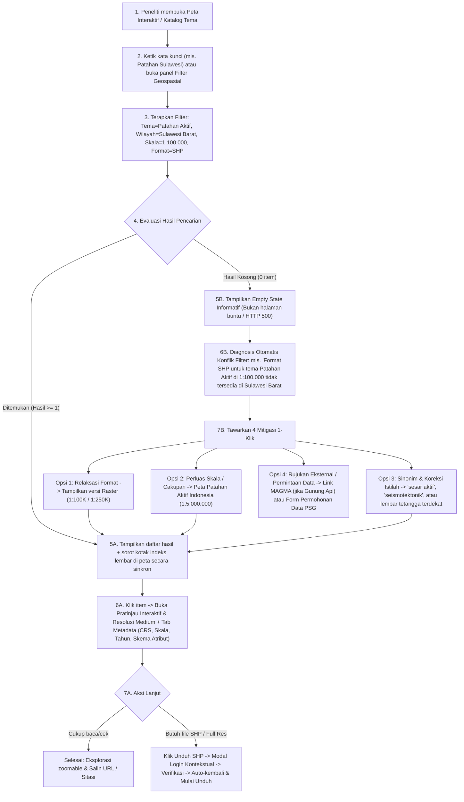
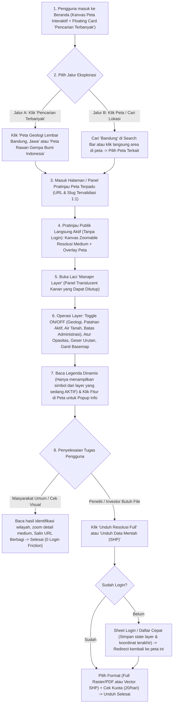
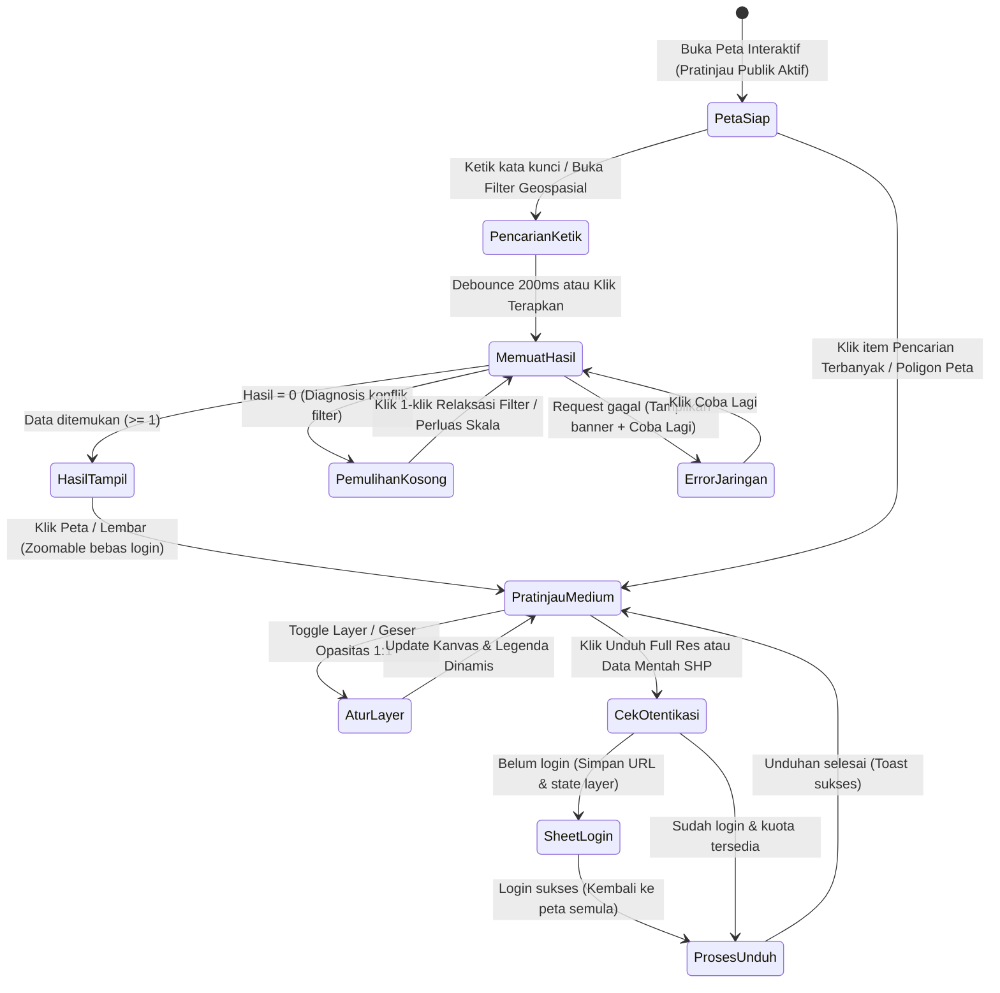

# Dokumen Lengkap Redesain Portal Web GeoMap Kementerian ESDM (Fase 1–4)

| Informasi Dokumen | Keterangan |
| :--- | :--- |
| **Target Sistem** | Portal Web GeoMap — Badan Geologi, Kementerian ESDM (`https://geologi.esdm.go.id/geomap`) |
| **Cakupan Fase** | Fase 1 (Discovery & Research), Fase 2 (IA & User Flow), Fase 3 (Wireframe, Design System 3-Layer, Motion Engineering & Upgrade v4), Fase 4 (Usability Testing, Design QA & Implementasi Produksi) |
| **Pendekatan Desain** | UX Geospasial + *Apple Design* (WWDC Fluid Interfaces & Liquid Glass) + `ui-ux-pro-max-skill` + `emilkowalski/skills` + *Pedoman Identitas Visual KESDM (FA LOGO ESDM 2025)* |
| **Implementasi & Pratinjau** | Aplikasi Produksi React + TypeScript + Vite + Leaflet (`src/`), Prototipe v3 (`geomap_esdm_interactive_design.html`), Kalibrasi Apple Header & Logo Resmi ESDM (`geomap_header_apple_comparison.html`), Resizing Search HUD (`geomap_search_panel_resize_comparison.html`) |
| **Status Verifikasi Kode** | `npm run typecheck` (`0` error) · `npm test` (**12/12 passed** di `src/App.test.tsx`) · `npm run build` (**sukses 1.22s**) |
| **Tanggal Pemutakhiran** | 11 November 2026 (Edisi Lengkap Pasca-Implementasi React & Kalibrasi UI v4) |

> **Catatan Evolusi Cakupan Lintas Fase (Fase 1 → Fase 4 & Implementasi Produksi):**  
> Dokumen gabungan ini mempertahankan seluruh catatan riset historis dari tiap fase beserta pembaruan keputusan hingga implementasi produksi akhir. Pada **Fase 2**, slot **Gunung Api** sempat direncanakan sebagai rujukan eksternal sementara ke PVMBG / MAGMA; pada **Fase 3 (Prototipe v2–v3)** tim menambahkan layer toggle `Sebaran Gunung Api (PVMBG)` (`8` gunung api aktif + tautan `https://magma.esdm.go.id`). Selanjutnya pada **Implementasi Produksi React v4 & Kalibrasi UI**, portal diperkuat dengan **21 dataset unik** (**11 Peta Skala Nasional `1:5.000.000`** + **10 Pencarian Terbanyak** & dataset regional/tematik), **22 fitur Indeks Lembar Peta** (`1:5.000.000`–`1:50.000`), panel pencarian simetris `332px`, **Header Apple Liquid Glass 58px (`Opsi 1`)**, **Logo Primer Horizontal Resmi KESDM 2025 (18 path vektor Positif & Negatif Kuning)**, serta **kalibrasi kontras Mode Gelap** bebas bias di atas peta topografi.

---

## Daftar Isi Dokumen

1. [BAB 1 — FASE 1: Discovery & Research Audit](#bab-1--fase-1-discovery--research-audit)
2. [BAB 2 — FASE 2: Arsitektur Informasi (Sitemap) & User Flow](#bab-2--fase-2-arsitektur-informasi-sitemap--user-flow)
3. [BAB 3A — FASE 3: Blueprint Wireframe, Komponen UI & State Diagram](#bab-3a--fase-3-blueprint-wireframe-komponen-ui--state-diagram)
4. [BAB 3B — FASE 3 (Lanjutan): Design System 3-Layer (Pro Max) & Motion Engineering (Emil Kowalski)](#bab-3b--fase-3-lanjutan-design-system-3-layer-pro-max--motion-engineering-emil-kowalski)
5. [BAB 4 — FASE 4: Usability Testing, Design QA & Implementasi Produksi](#bab-4--fase-4-usability-testing-design-qa--implementasi-produksi)

---

# BAB 1 — FASE 1: Discovery & Research Audit

**Target Audit:** `https://geologi.esdm.go.id/geomap` (GeoMap V 2.2.1 — Pusat Survei Geologi, Badan Geologi, Kementerian ESDM)  
**Cakupan Evaluasi:** Beranda & Peta Interaktif, Sistem Pencarian (*Advanced Search* & *Search Preferences*), Koleksi Peta, FAQ, Kebutuhan Bisnis & Pengguna, serta Analisis Kebutuhan Data.

> [!IMPORTANT]
> Seluruh temuan antarmuka, URL, nama field, bug HTTP, dan jumlah item di bawah ini berasal dari **inspeksi langsung melalui browser** terhadap situs live. Rekomendasi redesain ditandai terpisah sebagai arah perbaikan untuk fase perancangan berikutnya.

---

## Ringkasan Eksekutif: 5 Temuan Paling Kritis

1. **"Advanced Search" & "Search Preferences" adalah template HTML mati yang belum dikustomisasi.** Kedua panel berasal dari boilerplate tema *Metronic* berbahasa Inggris (`Users`, `Orders`, `Projects`, `Affiliate Programs`, `Referrals`, link demo mati `../../demo1/dist/pages/search/horizontal.html`), dan ikon pemicunya dikomentari di HTML sehingga tidak terlihat oleh pengguna.
2. **Pencarian sering crash (HTTP 500) tanpa pesan error ke pengguna.** Query seperti `"gunung api"` dan `"merapi"` pada `POST /geomap//pages/search` mengembalikan **HTTP 500** dengan body kosong; antarmuka hanya mencatatnya di console dan membiarkan daftar `"Pencarian Terbanyak:"` menggantung seolah tidak ada yang terjadi.
3. **Bug integritas data massal (*slug-to-title desynchronization*).** Judul peta di hasil pencarian, daftar provinsi/kabupaten, dan Koleksi Peta banyak yang tertukar (*off-by-one*) dengan URL tujuannya (contoh: judul *"Peta Geologi Lembar Bandung, Jawa"* mengarah ke `/pages/preview/peta-geologi-lembar-cianjur-jawa`; tautan SHP di tingkat kabupaten mengarah ke `/pages/preview/` tanpa slug sehingga diam-diam membuka Peta Geologi Indonesia `1:5.000.000`).
4. **Koleksi Peta (`8200 Peta`, `39 Tema`) tidak memiliki filter, sortir, ataupun pencarian.** Pengguna hanya disuguhi grid 20 kartu per halaman hingga 334 halaman (`6.680` item terjangkau), sementara format vektor (`SHP`) tersembunyi hanya di dalam *drill-down* peta tingkat Kabupaten/Kota.
5. **Data Gunung Api tidak tersedia di tampilan GeoMap yang diuji, dan pratinjau peta beresolusi rendah tanpa zoom.** Pratinjau `Peta Patahan Aktif Indonesia` dan `Peta Cekungan Sedimen Indonesia` hanya berupa gambar JPG statis `600×493px` yang diduplikasi di 3 slide carousel tanpa zoom, sedangkan unduhan penuh dibatasi wajib login (verifikasi email + reCAPTCHA + alasan minimal 20 karakter + kuota 20 peta/hari).

---

## 1. Audit Antarmuka Saat Ini (*Interface Audit*)

### 1.1 Beranda (`/geomap`) & Peta Interaktif 3 Level

#### Navigasi Global, Bahasa & Footer
- **Header (`#kt_header`, tinggi tetap `65px`):** Memuat logo GeoMap, 3 menu utama (`Beranda`, `Koleksi Peta`, `FAQ`; menu ke-4 `Isi Survei` dikomentari di HTML), tombol pencarian kaca pembesar di kanan atas (`#kt_header_search_toggle`, **tanpa `aria-label` maupun teks**), dan tombol `Masuk`.
- **Bahasa:** Tidak ada pengalih bahasa (*language toggle*). Markup memakai `<html lang="en">`, tetapi teks UI bercampur antara Indonesia dan Inggris (`Peta Dasar` vs `Base Map`, `Full Screen`, `Advanced Search`, `Search Preferences`, `"Frequesntly Asked Questions"`).
- **Footer:** Di Beranda tidak ada `#kt_footer` standar, digantikan dua bar atribusi gelap Leaflet (bar kiri memakai lebar inline statis `width: 1440px` yang tidak responsif pada viewport `1680px`; tautan `Pusat Survei Geologi` di bar kanan hanya mengarah ke `#`). Halaman turunan memakai footer putih standar.

#### Evaluasi Peta Interaktif & Manajemen Layer
Peta dibangun menggunakan **Leaflet 1.7.1** dengan basemap `Mapbox satellite-streets-v11` dan terpecah menjadi tiga level hierarki yang kaku:

| Aspek | Level 1: Beranda (`/geomap`) | Level 2: Provinsi (`/pages/province/76`) | Level 3: Kab/Kota (`/pages/district/76.06`) |
| :--- | :--- | :--- | :--- |
| **Kontrol Peta** | `+`, `-`, `Full Screen` | Duplikat `Full Screen` (header card + ikon Leaflet) | Sama dengan level Provinsi |
| **Kontrol GIS Standar yang Absen** | Tidak ada tombol *Home/Reset Extent*, *Measure*, *Legend*, pembaca koordinat, *Scale bar*, *Basemap switcher*, atau geocoder lokasi | Sama (tanpa legenda/ukur/basemap switcher) | Sama |
| **Panel Layer (kanan atas)** | Terbuka *default*; 1 base (`Peta Dasar`), 1 overlay (`Provinsi` — 38 poligon GeoJSON) | Terbuka *default* menutupi kuadran kanan atas; 1 base (`Peta Dasar`), 7 overlay (`Kabupaten / Kota` + 6 grid indeks) | Label base berubah tidak konsisten menjadi `Base Map`; 8 overlay grid indeks (`2M`, `1M`, `250K`, `100K`, `50K`) |
| **Widget & Aksi Tambahan** | Widget kiri bawah `PETA SKALA NASIONAL` (dropdown Select2 berisi 11 peta `1:5.000.000` + tombol `Pratinjau` berwarna abu-abu kontras rendah karena bentrok kelas `btn-primary` + `badge-light`) | Daftar peta provinsi di sidebar + popup Kab/Kota | Sidebar kanan menampilkan `SHP: Kab. / Kota` (`Vector / SHP`, `1 MB`) + lembar peta raster |

**Masalah Manajemen Layer & Interaksi yang Teramati:**
- **Overlay grid indeks tidak dapat dibedakan dan tidak interaktif:** Mengaktifkan `Indeks Geologi 250K` dan `Indeks Seismotektonik 250K` secara bersamaan menghasilkan kotak-kotak magenta/ungu bertumpuk tanpa **legenda**, tanpa pembeda warna, dan **tidak memunculkan popup** saat diklik.
- **Tooltip menempel (*stuck tooltips*):** Pada sesi peta Beranda, beberapa tooltip nama provinsi (4 buah sekaligus) dapat tertinggal di layar hingga peta di-zoom.
- **Inkonsistensi metrik data:** Popup Provinsi Sulawesi Barat di Beranda menampilkan `Jumlah Peta : 178`, tetapi halaman `/pages/province/76` menampilkan `29 Peta`.
- **Navigasi geografis terlalu panjang:** Untuk mencapai data lokal/SHP dari Beranda, pengguna harus melewati alur 4 langkah (`Beranda` → klik Provinsi → `Detail` → klik Kab/Kota → `Detail`).

---

### 1.2 Audit Sistem Pencarian: *Search*, *Advanced Search*, & *Search Preferences*

#### Popover Pencarian Header (`#kt_header_search`)
- **Mekanisme input:** Pencarian instan saat mengetik dimatikan (`data-kt-search-keypress="false"`, `data-kt-search-enter="true"`). Pengguna wajib menekan `Enter`, lalu sistem menunggu **`setTimeout` statis 1500 ms** sebelum mengirim `POST /geomap//pages/search`.
- **Kontrol tersembunyi:** Di dalam DOM toolbar pencarian terdapat tombol pemicu **Search Preferences** (`[data-kt-search-element="preferences-show"]`) dan **Advanced Search** (`[data-kt-search-element="advanced-options-form-show"]`), namun **tag `<svg>` ikonnya dikomentari di HTML** sehingga kedua tombol tidak tampak secara visual. Selain itu, begitu teks diketik, toolbar tersebut disembunyikan oleh skrip `KTSearch`.

#### Rincian Field yang Ditemukan di DOM

| Panel | Elemen & Field Aktual yang Terlihat di Kode/UI | Masalah Kritis |
| :--- | :--- | :--- |
| **Advanced Search** (`advanced-options-form`) | • Heading: `Advanced Search`<br>• Text: `query` (*"Contains the word"*)<br>• Radio `type`: `All`, `Users`, `Orders`, `Projects`<br>• Text: `assignedto` (*"Assigned to"*), `collaborators` (*"Collaborators"*)<br>• Radio `attachment`: `Has attachment`, `Any`<br>• Select2 `timezone` (`aria-label="Select a Timezone"`): `Within the next`, `Within the last`, `Between`, `On`<br>• Number: `date_number` (placeholder salah ketik `"Lenght"`)<br>• Select2 `date_typer`: `Days`, `Weeks`, `Months`, `Years`<br>• Tombol: `Cancel`, `Search` (`href="../../demo1/dist/pages/search/horizontal.html"`) | 100% sisa template CRM/Manajemen Proyek Metronic berbahasa Inggris; **tidak ada satu pun parameter geospasial** (tema, skala, provinsi, format Raster/SHP, tahun, koordinat/bbox); tombol `Search` mengarah ke file demo lokal yang rusak. |
| **Search Preferences** (`preferences`) | • Heading: `Search Preferences`<br>• 5 switch checkbox tanpa atribut `name`: `Projects` (on), `Targets` (on), `Affiliate Programs` (off), `Referrals` (on), `Users` (off)<br>• Tombol: `Cancel`, `Save Changes` | Tidak terhubung ke preferensi pencarian peta (seperti preferensi format vektor/raster, skala default, atau basemap). |

#### Masalah Pengalaman Pencarian Lainnya
- **Pencarian tidak mendukung filter domain:** Tidak ada filter tema, skala (`1:50K`–`1:5M`), wilayah administrasi, ataupun format file (`Raster` vs `SHP`).
- **Hasil ambigu / berisik:** Kata kunci `"air tanah"` mengembalikan 100+ hasil termasuk tema yang kurang relevan (`Peta Kerentanan Likuefaksi`, `Peta Sebaran Tanah Lunak Indonesia`). Kata kunci `"gunung"` hanya mencocokkan nama lembar geografis (`Lembar Gunung Doom`, `Lembar Gunung Hijau`), bukan peta tematik gunung api.
- **Pencarian di sidebar FAQ mati total:** Input `Pencarian` di `/pages/faq` tidak memfilter daftar karena `/geomap/js/theme/custom/pages/faq/faq.js` gagal dimuat (**HTTP 404**).

---

### 1.3 Audit Halaman Koleksi Peta (`/pages/collection`) & Pratinjau (`/pages/preview/...`)

#### Halaman Koleksi Peta
- **Header katalog:** Menampilkan judul `Koleksi Peta` dengan badge `39 Tema` dan `8200 Peta`. Terdapat tab `Peta` yang tidak interaktif (tab `Settings` menuju template demo dikomentari).
- **Ketiadaan navigasi katalog:** **Tidak ada** filter berdasarkan tema (dari 39 tema yang diklaim), tidak ada filter skala, tidak ada filter provinsi, tidak ada sortir (terbaru/terpopuler/A–Z), dan tidak ada kolom cari di dalam halaman.
- **Paginasi & selisih data:** Grid menampilkan `4 × 5` = 20 kartu per halaman hingga halaman `?page_collections=334` (maksimal `6.680` item dapat diakses, lebih sedikit dari klaim `8200 Peta`).
- **Kartu item:** Hanya menampilkan thumbnail, judul, teks skala, dan tombol `Pratinjau` — tanpa badge tema, format (`Raster` / `SHP`), provinsi, maupun tahun publikasi. Penyelarasan tombol antar kartu tidak sejajar karena tinggi baris judul berbeda-beda.

#### Halaman Detail / Pratinjau (`Peta Patahan Aktif Indonesia` & `Peta Cekungan Sedimen Indonesia`)
- **Viewer pratinjau tidak memadai:** Kedua halaman hanya menampilkan gambar JPG statis `600×493px` (`gpa_5m_01_med.jpg` dan `gcs_5m_01_med.jpg`) yang **diulang identik pada 3 slide Bootstrap carousel**, tanpa kontrol *zoom*, *pan*, atau pratinjau interaktif sehingga legenda peta tidak dapat dibaca.
- **Metadata & statistik duplikat:** Menampilkan penerbit (`Pusat Survei Geologi`), tanggal publikasi (`1st Jan 2021` / `21st Oct 2022`), tema, skala, indeks lembar, dan tombol `Salin URL`. Angka kunjungan & unduhan ditampilkan ganda di badge kanan atas dan kartu `Statistik`.
- **Pembatasan akses & format:** Hanya tersedia tombol `Unduh Raster` (`12 MB` / `11 MB`) tanpa keterangan ekstensi file (PDF/JPG/GeoTIFF), tanpa opsi `SHP`/`GeoJSON`/`WMS`, dan wajib login (`/pages/signin/map/...`).

---

### 1.4 Audit Halaman FAQ (`/pages/faq`)

- **Struktur & Volume:** Layout 2 kolom (sidebar kiri: `Kategori FAQ`, `Pencarian`, `Paling Banyak Dicari`; area utama: pengantar + 27 item accordion Bootstrap + banner media sosial di bawah; terdapat pula markup `Video Tutorial` yang disembunyikan).
- **Bug Fungsional & Aset (10 HTTP 404):**
  - Sidebar mencantumkan kategori ke-5 `Informasi Peta Kegeologian` (`#category-5`), namun elemen `#category-5` **tidak ada di DOM** sehingga klik tidak berfungsi; 11 pertanyaan geologi justru tergabung tanpa judul di bawah kategori ke-4 `Layanan Hubungan Pelanggan (Customer Service)`.
  - Input `Pencarian` tidak bekerja (`faq.js` 404).
  - Thumbnail `Paling Banyak Dicari` (`img-1.jpg`) dan seluruh 7 ikon media sosial di bawah 404, menyisakan kotak abu-abu kosong.
- **Kualitas Konten & Copy:**
  - Salah ketik di judul utama: `"Frequesntly Asked Questions (FAQ)"`.
  - Pertanyaan batas unduhan harian muncul ganda (#9 dan #25).
  - Menyebut elemen antarmuka yang tidak sesuai dengan situs live saat ini (misalnya meminta pengguna mengklik `"Report"` di halaman peta atau `"menu Pesan"`).
  - **Celah informasi untuk pengguna teknis & bisnis:** Tidak menjelaskan sistem koordinat/datum (`CRS/WGS84`), struktur atribut file `SHP`, resolusi/format file raster, kejelasan hak penggunaan komersial bagi investor, serta tidak ada dokumentasi layanan peta terbuka (`WMS/WFS/API`).

---

### 1.5 Performa & Kualitas Teknis Tambahan

- **Waktu Muat Awal:** Load awal Beranda mencatat `domInteractive: 5247 ms` dan `loadEventEnd: 6499 ms` (navigasi awal sempat melewati batas tunggu `10000 ms`).
- **Mixed Content:** Beranda memuat skrip `http://openlayers.org/api/OpenLayers.js` yang diblokir oleh browser karena halaman berjalan di atas HTTPS.
- **Inkonsistensi Penamaan Data:** Terdapat banyak salah ketik pada judul dataset (seperti `Satua`, `riau`, `Lampupng`, `Kerantanan`, `Yogyakata`, `Darusalam`, `provinvi`, `Provinsi Jawa Sumatera Barat`) dan penulisan skala yang tidak seragam (`1:100.000` vs `1: 300.000`).

---

## 2. Pemahaman Tujuan Bisnis & Segmentasi Pengguna

Agar redesain GeoMap benar-benar menyederhanakan navigasi peta interaktif, pencarian, dan manajemen layer, setiap kelompok pengguna memiliki kebutuhan alur kerja (*user flow*) yang berbeda:

| Segmen Pengguna | Tujuan Utama & Pekerjaan yang Ingin Diselesaikan | Hambatan Terbesar di Situs Saat Ini | Kebutuhan Kunci pada Redesain |
| :--- | :--- | :--- | :--- |
| **Masyarakat Umum** | Memeriksa kondisi geologi/kebencanaan di sekitar tempat tinggal (sesar/patahan aktif, rawan gempa, likuefaksi, air tanah) secara cepat dan mudah dipahami. | Tidak ada pencarian nama kota/alamat langsung di peta; istilah indeks lembar (`250K`, `100K`) membingungkan; pratinjau tidak bisa di-zoom; harus daftar akun & verifikasi email hanya untuk melihat peta dengan jelas. | • Geocoder/pencarian lokasi berbasis nama daerah & koordinat di kanvas peta.<br>• Layer tematik siap-klik dengan legenda visual sederhana & popup informasi lokal.<br>• Pratinjau resolusi penuh (zoomable) tanpa wajib login. |
| **Peneliti & Akademisi** | Mengunduh data spasial siap olah (`SHP`/vektor, raster georeferensi/GeoTIFF), menyaring berdasarkan tema/skala/tahun/lembar, serta memeriksa metadata dan datum/atribut. | `Koleksi Peta` tanpa filter sama sekali; `Advanced Search` rusak (template kosong); data `SHP` tersembunyi hanya di level Kab/Kota; banyak tautan peta tertukar (*slug desynchronization*); tidak ada dokumentasi CRS/atribut/WMS. | • Filter katalog multi-faset (Tema, Skala, Format `Raster/SHP`, Provinsi, Tahun, Bounding Box peta).<br>• Manajemen layer interaktif (toggle multi-layer, slider opasitas, urutan layer, legenda dinamis, inspect atribut fitur).<br>• Halaman detail dengan metadata teknis lengkap & preview zoomable. |
| **Investor & Perencana** | Menilai kelayakan wilayah untuk pertambangan, panas bumi, migas (cekungan sedimen), infrastruktur, dan tata ruang (sumber daya mineral, batubara, air tanah, tanah lunak, patahan). | Tidak bisa memfilter koleksi berdasarkan sektor/komoditas atau melihat cakupan nasional sekaligus tanpa bolak-balik halaman; tidak ada kejelasan lisensi pemanfaatan bisnis di FAQ; proses login & kuota 20/hari menghambat eksplorasi cepat. | • Preset/kurasi kategori strategis (Energi & Migas, Mineral & Batubara, Kebencanaan, Infrastruktur/Geoteknik, Hidrogeologi).<br>• Multi-layer overlay di satu peta interaktif (mis. overlay *Cekungan Sedimen* + *Patahan Aktif* + *Batas Administrasi*).<br>• Kejelasan lisensi terbuka/komersial & integritas tautan unduhan. |

### Arah Desain Interaksi & Manajemen Layer (Selaras dengan Prinsip *Apple Design*)
Untuk mewujudkan antarmuka yang terasa cepat, langsung, dan tidak membingungkan:
1. **Kanvas Peta Penuh dengan Chrome Mengambang (*Materials & Depth*):** Jadikan peta interaktif sebagai kanvas utama yang lega, dengan panel pencarian, layer manager, dan legenda sebagai panel mengambang semi-transparan (`backdrop-filter`) yang dapat dibuka-tutup (*collapsible*), bukan menimpa peta secara permanen di pojok kanan atas.
2. **Respons Instan Tanpa Delay Buatan (*Kill Latency*):** Hilangkan `setTimeout` 1500 ms pada pencarian; tampilkan hasil cepat (*instant suggestions*) saat mengetik dengan kategori yang jelas (Lokasi, Tema Peta, Lembar Peta) dan status error/kosong yang eksplisit.
3. **Kontrol Terpadu & Dapat Dibalik (*Wayfinding & Interruptibility*):** Sediakan tombol *Home/Reset Extent*, *Basemap Switcher*, *Coordinate & Scale Bar*, serta kontrol layer yang konsisten (ubah opasitas, nyalakan/matikan, lihat legenda langsung di samping nama layer).
4. **Pengelompokan & Penamaan Langsung (*Grouping & Specific Labels*):** Ganti label ambigu (`Peta Dasar` vs `Base Map`) dengan label Bahasa Indonesia yang konsisten (atau sediakan pengalih bahasa ID/EN yang utuh), dan jadikan tombol aksi utama (seperti `Pratinjau`, `Buka di Peta`, `Unduh SHP/Raster`) jelas kontrasnya dan konsisten posisinya.

---

## 3. Analisis Kebutuhan Data & Koleksi Geospasial

Berdasarkan audit langsung pada **Beranda (11 Peta Skala Nasional)**, **Koleksi Peta**, **Level Provinsi/Kabupaten**, **Pencarian**, dan **Pratinjau**, berikut pemetaan data yang terkonfirmasi tersedia versus celah yang harus ditangani pada redesain:

### 3.1 Matriks Ketersediaan Data Inti

| Domain Data | Koleksi / Tema Teramati di GeoMap | Skala & Format Teramati | Status & Temuan Penting |
| :--- | :--- | :--- | :--- |
| **Geologi Dasar** | • `Peta Geologi Indonesia`<br>• `Peta Geologi` (lembar regional)<br>• `Peta Geologi Interpretasi` / `Peta Geologi Inderaan Jauh`<br>• `Vector / SHP` Geologi per Kab/Kota | `1:5.000.000`, `1:250.000`, `1:100.000`, `1:50.000` (Raster + `SHP` di Kab/Kota) | Tersedia luas, tetapi versi `SHP` tidak terlihat di katalog `Koleksi Peta` dan preview `SHP` di Kab/Kota Mamuju Tengah rusak (`/pages/preview/`). |
| **Patahan / Sesar Aktif** | • **`Peta Patahan Aktif Indonesia`**<br>• Peta Patahan Aktif lembar Kab/Kota (mis. Sukabumi, Cianjur, Bandung, Surabaya) | `1:5.000.000` & `1:100.000` (Raster) | Tersedia sebagai item unggulan; pratinjau hanya JPG `600×493px` tanpa zoom sehingga detail segmen patahan sulit dibaca tanpa mengunduh 12 MB setelah login. |
| **Cekungan Sedimen** | • **`Peta Cekungan Sedimen Indonesia`**<br>• `Peta Cekungan Sedimen Indonesia Berdasarkan Anomali Gaya Berat` | `1:5.000.000` (Raster) | Tersedia; sangat bernilai bagi peneliti/investor migas, namun belum bisa di-overlay langsung sebagai layer interaktif di peta Beranda. |
| **Air Tanah (Hidrogeologi)** | • `Peta Hidrogeologi`<br>• `Peta Ketersediaan Air Tanah`<br>• `Peta Cekungan Air Tanah` | `1:250.000` & `1:100.000`–`1:2.000.000` (Raster) | Tersedia di sistem, tetapi pencarian kata kunci `"air tanah"` mengembalikan hasil bercampur dengan likuefaksi dan tanah lunak karena tidak ada filter tema. |
| **Gunung Api (Vulkanologi)** | **Tidak ditemukan tema/koleksi Gunung Api** di daftar Nasional (`1:5M`), Koleksi Peta hal. 1, Provinsi `76`, maupun Kab/Kota `76.06`. | — | **Celah kritis:** Pencarian `"gunung api"` & `"merapi"` menghasilkan **HTTP 500**; `"gunung"` hanya menampilkan nama lembar peta; FAQ #17 menyebut PVMBG sebagai unit kontributor, namun datanya tidak terekspos di tampilan GeoMap yang diuji. |

### 3.2 Tema Tambahan yang Teridentifikasi di Ekosistem GeoMap
Selain 5 fokus di atas, audit menemukan tema-tema berikut yang perlu dikelompokkan dalam taksonomi filter baru:
- **Sumber Daya Energi & Mineral:** `Peta Metalogeni Indonesia`, `Peta Lokasi dan Potensi Panas Bumi`, `Peta Distribusi dan Sumber Daya Panas Bumi`, `Peta Potensi Mineral Logam dan Sebaran Satuan Batuan Pembawa Logam`, `Peta Sebaran Satuan Batuan Pembawa Logam`, `Peta Potensi Mineral Bukan Logam dan Batuan`, `Peta Sebaran Lokasi Batubara`, `Peta Sebaran Formasi Pembawa Batubara`, `Peta Potensi Gambut`, `Peta Citra Kesamaan Uranium`.
- **Geofisika & Tektonik:** `Peta Anomali Bouguer Indonesia` (termasuk versi `2025`), `Peta Seismotektonik Indonesia`, `Peta Sebaran Arah Kemagnetan Purba di Indonesia`, `Peta Sebaran Umur Radiometri di Indonesia`.
- **Kebencanaan & Geologi Teknik:** `Peta Rawan Gempa Bumi`, `Peta Kerentanan Likuefaksi`, `Peta Sebaran Tanah Lunak Indonesia`, `Peta Geologi Tata Lingkungan`.
- **Geomorfologi & Penginderaan Jauh:** `Peta Geomorfologi Inderaan Jauh Indonesia`, `Peta Geomorfologi`, `Peta Foto Geomorfologi`, `Peta Citra Satelit Landsat`.

### 3.3 Kebutuhan Arsitektur Data Sebelum / Saat Redesain
1. **Penyusunan Taksonomi Kategori (dari 39 tema mentah → 5–6 kelompok inti):** Mengelompokkan 39 tema ke dalam kategori yang mudah dipahami pengguna awam hingga ahli (misalnya: *Geologi & Geomorfologi*, *Tektonik, Patahan & Kebencanaan*, *Energi & Sumber Daya Mineral*, *Hidrogeologi & Air Tanah*, *Geofisika*, dan *Gunung Api* jika diintegrasikan).
2. **Normalisasi Metadata per Koleksi:** Setiap dataset wajib memiliki atribut terstruktur untuk filter: `judul` (bebas typo), `slug` yang sinkron 1:1 dengan judul, `tema`, `skala`, `cakupan_wilayah` (Nasional / Provinsi / Kab-Kota / Lembar), `tahun_publikasi`, `format_tersedia` (`Raster`, `SHP`, `GeoJSON`, `WMS`), `ukuran_file`, dan `crs_datum`.
3. **Integrasi Layer Interaktif vs Unduhan Statis:** Peta kunci seperti **Peta Patahan Aktif Indonesia** dan **Peta Cekungan Sedimen Indonesia** sebaiknya tidak hanya tersedia sebagai gambar statis `12 MB`, tetapi dapat langsung diaktifkan (*toggle*) sebagai layer interaktif di peta utama lengkap dengan legenda dan info fitur saat diklik.

---

## Keputusan Terbuka untuk Fase Selanjutnya

Sebelum masuk ke **Fase Perancangan (Information Architecture, Wireframe / Prototype, atau Implementasi di Workspace `Geomap WEB`)**, beberapa hal berikut perlu disepakati:
1. **Cakupan Data Gunung Api:** Apakah pada redesain ini layer/data gunung api akan ditambahkan/diintegrasikan (misalnya dari layanan PVMBG / *MAGMA Indonesia* atau data dummy representatif untuk prototipe), atau diarahkan lewat tautan terintegrasi?
2. **Kebijakan Akses & Pratinjau:** Apakah pratinjau peta beresolusi tinggi (zoomable/interaktif) dibuka untuk publik tanpa login, sementara login hanya diterapkan untuk unduh data mentah (`SHP`/Raster penuh), atau tetap menggunakan alur otentikasi?
3. **Target Output Berikutnya:** Apakah setelah laporan ini Anda ingin langsung lanjut ke **Information Architecture & Wireframe/Spesifikasi Desain** atau mulai membangun **Prototipe Web Interaktif** di workspace `Geomap WEB` dengan prinsip desain `apple-design`?

---

# BAB 2 — FASE 2: Arsitektur Informasi (Sitemap) & User Flow

**Basis Audit:** **Bab 1 (Discovery & Research Audit)**  
**Lensa Perancangan:** UX Architecture Geospasial + Prinsip *Apple Design* (*Direct manipulation, Kill latency, Wayfinding, Grouping & mapping, Direct specific labels, Materials & depth*)

> [!NOTE]
> **Kesepakatan Cakupan Produk pada Fase 2:**
> 1. **Kebijakan Akses:** Eksplorasi peta interaktif dan pratinjau **resolusi medium (zoomable)** dibuka gratis untuk publik tanpa login; **otentikasi (`Masuk`)** hanya diminta saat mengunduh **resolusi penuh (cetak/GeoTIFF)** dan **data mentah spasial (`SHP` / vektor)**, dengan pemulihan konteks agar pengguna kembali ke peta/dataset terakhir.
> 2. **Data Gunung Api:** Disiapkan slot taksonomi pada struktur katalog dan filter agar arsitektur siap untuk data *geologi, patahan, gunung api, dan air tanah*, namun **integrasi layer live Gunung Api ditunda ke fase lanjutan** (*future/external link ke PVMBG / MAGMA Indonesia*) sesuai keputusan produk saat ini.

---

## 1. Arsitektur Informasi Baru (Sitemap & Taksonomi)

### 1.1 Transformasi Navigasi Utama
Di situs eksisting, menu teratas hanya terdiri atas `Beranda`, `Koleksi Peta` (1 keranjang besar berisi 8.200 peta tanpa filter), `FAQ`, dan `Masuk`. Sesuai prinsip **Direct, specific labels** (*Apple Design* §16), label generik `"Koleksi Peta"` dipecah berdasarkan **cara berpikir dan tujuan tugas pengguna**: *mau menjelajah langsung di peta*, *mau menyaring dataset tematik*, *mau mengunduh peta nasional siap pakai*, atau *mau memahami spesifikasi data & bantuan*.

| Navigasi Lama | Navigasi Baru (Top Bar) | Alasan UX & Pemetaan Tujuan |
| :--- | :--- | :--- |
| `Beranda` | **`Peta Interaktif`** *(Landing utama — kanvas peta penuh + ringkasan cepat)* | Menghilangkan sekat antara beranda dan eksplorasi spasial; pengguna langsung bisa mencari kota/lembar dan mengaktifkan layer tanpa *drill-down* 4 klik. |
| `Koleksi Peta` *(terlalu umum, 0 filter)* | **`Katalog Tema`** *(dropdown/mega-menu 6 klaster tematik)* | Memecah 39 tema mentah menjadi 6 domain geospasial yang langsung dipahami masyarakat umum, peneliti, dan investor. |
| *(Tersembunyi di widget kecil Beranda)* | **`Peta Nasional`** *(kurasi 11+ peta skala `1:5.000.000`)* | Mengangkat produk unggulan seperti *Peta Geologi Indonesia*, *Peta Patahan Aktif Indonesia*, dan *Peta Cekungan Sedimen Indonesia* menjadi akses tingkat 1. |
| *(Terkubur di Kab/Kota)* | **`Data Vektor & SHP`** *(filter khusus data olah GIS)* | Memudahkan peneliti & konsultan menemukan data `SHP` tanpa harus menebak alur *Provinsi → Kabupaten/Kota*. |
| `FAQ` | **`Panduan & FAQ`** *(FAQ, Glosarium, Spesifikasi Format/CRS, Status Data)* | Menggabungkan FAQ yang diperbaiki (fix 404 & `#category-5`) dengan dokumentasi CRS/datum, lisensi, dan catatan cakupan data. |
| `Masuk` + ikon cari tanpa label | **Bilah Pencarian Cepat (`⌘K` / `/`)** + **`Unduhan Saya` / `Masuk`** | Mengubah ikon kaca pembesar tanpa label menjadi bilah pencarian eksplisit dengan pintasan keyboard dan indikator akun/kuota harian. |

### 1.2 Sitemap Lengkap (Arsitektur Baru)

```mermaid
flowchart TD
    ROOT["GeoMap ESDM Portal (geologi.esdm.go.id/geomap)"]

    ROOT --> NAV1["Peta Interaktif (Landing / Beranda)"]
    ROOT --> NAV2["Katalog Tema (Pengganti Koleksi Peta)"]
    ROOT --> NAV3["Peta Nasional (Skala 1:5.000.000)"]
    ROOT --> NAV4["Data Vektor & SHP (Siap Olah GIS)"]
    ROOT --> NAV5["Panduan & FAQ"]
    ROOT --> NAV6["Akun & Unduhan (Otentikasi)"]

    NAV1 --> M1["Pencarian Lokasi, Lembar & Tema (Instant Search + Filter)"]
    NAV1 --> M2["Manajer Layer & Legenda Dinamis (Geologi, Patahan, Air Tanah, Indeks)"]
    NAV1 --> M3["Panel Pratinjau Cepat (Resolusi Medium Tanpa Login)"]
    NAV1 --> M4["Pencarian Terbanyak & Akses Cepat Nasional"]

    NAV2 --> T1["Geologi & Geomorfologi (Geologi Dasar, Inderaan Jauh, Landsat)"]
    NAV2 --> T2["Patahan & Kebencanaan (Patahan Aktif, Gempa Bumi, Likuefaksi, Tanah Lunak)"]
    NAV2 --> T3["Air Tanah & Hidrogeologi (Cekungan Air Tanah, Ketersediaan Air Tanah)"]
    NAV2 --> T4["Energi, Sedimen & Mineral (Cekungan Sedimen, Panas Bumi, Migas, Batubara, Logam)"]
    NAV2 --> T5["Geofisika & Tektonik (Anomali Bouguer, Seismotektonik, Radiometri, Magnet Purba)"]
    NAV2 --> T6["Gunung Api (Slot Terencana — Rujukan PVMBG / MAGMA Indonesia)"]

    NAV3 --> N1["Peta Geologi Indonesia 1:5M"]
    NAV3 --> N2["Peta Patahan Aktif Indonesia 1:5M"]
    NAV3 --> N3["Peta Cekungan Sedimen Indonesia 1:5M & Gaya Berat"]
    NAV3 --> N4["Peta Metalogeni, Seismotektonik & Anomali Bouguer 2025"]

    NAV4 --> V1["Peta Geologi Vektor SHP per Kab/Kota (1:100.000)"]
    NAV4 --> V2["Paket Unduhan & Metadata Skema Atribut"]

    NAV5 --> F1["FAQ Terindeks & Pencarian Bantuan"]
    NAV5 --> F2["Panduan Navigasi & Skala Lembar Peta"]
    NAV5 --> F3["Spesifikasi Teknis (Datum, CRS, Format File, Lisensi)"]
    NAV5 --> F4["Status Data & Integrasi Layanan ESDM (termasuk rujukan Gunung Api)"]

    NAV6 --> A1["Masuk / Daftar / Verifikasi Email"]
    NAV6 --> A2["Riwayat & Kuota Unduhan Harian (20/hari)"]
    NAV6 --> A3["Akses Unduh Full Resolution & Data Mentah SHP"]
```



### 1.3 Taksonomi Katalog Pengganti `"Koleksi Peta"` (39 Tema → 6 Klaster)

Agar pengguna tidak tersesat di dalam `8200 Peta` pada 334 halaman tanpa saringan, setiap dataset wajib diklasifikasikan ke dalam **taksonomi 3 tingkat**: **Klaster Domain → Tema Spesifik → Cakupan & Skala**:

| Klaster Utama (Level 1) | Tema Tercakup (Level 2 — Dari Temuan Audit) | Target Persona Dominan |
| :--- | :--- | :--- |
| **1. Geologi & Geomorfologi** | `Peta Geologi`, `Peta Geologi Interpretasi / Inderaan Jauh`, `Peta Geomorfologi`, `Peta Foto Geomorfologi`, `Peta Citra Satelit Landsat`, `Peta Geologi Tata Lingkungan` | Peneliti, Mahasiswa, Perencana Wilayah |
| **2. Patahan & Kebencanaan** | `Peta Patahan Aktif`, `Peta Rawan Gempa Bumi`, `Peta Kerentanan Likuefaksi`, `Peta Sebaran Tanah Lunak Indonesia` | Masyarakat Umum, BPBD, Infrastruktur, Investor |
| **3. Air Tanah & Hidrogeologi** | `Peta Hidrogeologi`, `Peta Cekungan Air Tanah`, `Peta Ketersediaan Air Tanah` | Masyarakat Umum, Industri, Tata Ruang, Peneliti |
| **4. Energi, Cekungan Sedimen & Mineral** | `Peta Cekungan Sedimen Indonesia`, `Peta Cekungan Sedimen (Anomali Gaya Berat)`, `Peta Metalogeni`, `Peta Lokasi & Distribusi Panas Bumi`, `Peta Mineral Logam`, `Peta Mineral Bukan Logam & Batuan`, `Peta Batubara`, `Peta Potensi Gambut`, `Peta Citra Kesamaan Uranium` | Investor, Pertambangan, Migas, Energi Terbarukan |
| **5. Geofisika & Tektonik** | `Peta Anomali Bouguer` (termasuk pemutakhiran 2025), `Peta Seismotektonik`, `Peta Sebaran Umur Radiometri`, `Peta Sebaran Arah Kemagnetan Purba` | Peneliti Geofisika, Akademisi |
| **6. Gunung Api** *(Slot Terencana)* | Status saat ini: *Belum tersedia sebagai dataset GeoMap langsung (ditunda ke fase berikut)* — menampilkan kartu informasi terarah dengan tautan rujukan ke **PVMBG / MAGMA Indonesia** agar pencarian user tidak berakhir error 500 atau buntu. | Masyarakat Umum, Peneliti Kebencanaan |

---

## 2. Spesifikasi Baru: *Advanced Search* & *Search Preferences* Geospasial

Seluruh field template Metronic yang tidak relevan (`Users`, `Orders`, `Projects`, `Assigned to`, `Collaborators`, `Has attachment`, `Affiliate Programs`, `Referrals`, `Within the next/last Days`) **dihapus total** dan diganti dengan sistem **Filter Geospasial Progresif** (*Simplicity — show common path first, advanced options one level deeper*).

### 2.1 Bar Pencarian Utama & *Instant Search*
- **Input tunggal cerdas:** Mendukung pencarian **Nama Peta / Topik** (`"Patahan Aktif"`, `"Bandung"`), **Lokasi Administratif** (`"Jawa Barat"`, `"Mamuju Tengah"`), **Nomor Lembar** (`"1209-3"`), atau **Koordinat** (`-6.9175, 107.6191`).
- **Tanpa delay buatan:** Menghapus `setTimeout` 1500 ms; memakai *debounce* ringan (~200 ms) yang tetap *interruptible* saat pengguna mengetik ulang.
- **Pengelompokan hasil instan:** Memisahkan saran menjadi `Lokasi di Peta`, `Tema Peta`, dan `Koleksi / Lembar Peta`.

### 2.2 Parameter *Advanced Search* (Filter Spasial Baru)

| Kategori Filter | Nama Parameter (UI Label) | Jenis Kontrol & Pilihan Nilai | Manfaat Utama |
| :--- | :--- | :--- | :--- |
| **Klaster & Tema** | `Kategori / Tema Data` | Multi-select terkelompok (6 klaster utama → sub-tema seperti *Geologi*, *Patahan Aktif*, *Air Tanah*, *Cekungan Sedimen*, *Mineral/Energi*) | Mengganti `type: Users/Orders/Projects`; langsung menyaring 39 tema tanpa perlu menebak istilah. |
| **Wilayah & Ruang** | `Cakupan Wilayah` | Cascading select: `Nasional` / `Provinsi` / `Kabupaten-Kota` / `Area di Peta Saat Ini (Bounding Box)` | Peneliti dapat membatasi hasil hanya pada area yang sedang dilihat di viewport peta (*"Cari di area peta ini"*). |
| **Skala Peta** | `Skala` | Chip multi-pilih: `1:5.000.000 (Nasional)`, `1:250.000 (Regional)`, `1:100.000 (Kab/Kota)`, `1:50.000 (Detail)`, `Lainnya` | Memungkinkan pemisahan cepat antara gambaran makro investor (`1:5M`) vs analisis detail peneliti (`1:100K`–`1:50K`). |
| **Format & Akses** | `Format Tersedia` | Toggle pill: `Semua`, `Peta Interaktif / Raster`, `Vektor (SHP)` | Memastikan pengguna GIS tidak membuka puluhan peta raster jika hanya membutuhkan `SHP`. |
| **Rentang Tahun** | `Tahun Publikasi / Pemutakhiran` | Range slider / Dari–Sampai tahun (mis. `2015–2026`) atau chip `Terbaru (5 tahun terakhir)` | Mengganti filter CRM *“Within the next X Days/Weeks”* dengan tahun terbit peta geologi yang bermakna. |
| **Pengurutan** | `Urutkan Berdasarkan` | Dropdown: `Paling Relevan`, `Paling Populer`, `Terbaru`, `Skala (Detail ke Nasional)` | Memberi kendali prioritas pencarian yang selama ini tidak ada di Koleksi Peta. |

### 2.3 Parameter *Search Preferences* Baru (Preferensi Pengguna)
Panel **Search Preferences** (tersimpan di `localStorage` untuk tamu, atau profil akun untuk pengguna login) berfungsi menyesuaikan kenyamanan eksplorasi:
1. **Format Prioritas Default:** `Tampilkan Semua` / `Utamakan Vektor (SHP)` / `Utamakan Raster Siap Cetak`.
2. **Skala Default Pencarian:** `Semua Skala` / `Detail (≤ 1:100.000)` / `Nasional (1:5.000.000)`.
3. **Mode Tampilan Hasil:** `Daftar + Pin di Peta` (sinkron spasial) vs `Grid Katalog`.
4. **Basemap Awal:** `Peta Jalan / Topografi` / `Citra Satelit` / `Relief (Terrain)` — membantu keterbacaan overlay geologi berwarna.
5. **Pengaturan Aksesibilitas & Gerak (*Apple Design* §14):** Hormati otomatis `prefers-reduced-motion` dan `prefers-reduced-transparency` sistem, serta opsi kontras panel tinggi untuk keterbacaan label di lapangan/layar terang.

---

## 3. User Flow 1 — Pencarian & Penyaringan Data oleh Peneliti (Termasuk Pemulihan Hasil Kosong)

**Skenario:** Seorang peneliti kebencanaan/geologi ingin mencari **data vektor (`SHP`) Peta Patahan Aktif atau Peta Geologi skala `1:100.000`** untuk wilayah penelitian di **Sulawesi Tengah / Mamuju** dan memahami alur jika filter terlalu sempit atau data belum tersedia.



### Rincian Langkah & Mekanisme Pemulihan (*Zero-Result Recovery*)

1. **Akses Masuk Tanpa Friksi:** Peneliti mengetik di bilah pencarian atas atau menekan tombol **`Filter Lanjutan`** yang terlihat jelas di samping kolom cari (bukan tersembunyi di balik ikon SVG kosong).
2. **Penyaringan Multi-Faset dengan Umpan Balik Langsung (*Instant Count*):** Saat peneliti mencentang `Tema: Patahan Aktif`, `Wilayah: Sulawesi Barat`, `Skala: 1:100.000`, dan `Format: Vektor (SHP)`, badge jumlah hasil langsung memperbarui pratinjau hitungan (*mis. "0 peta cocok dengan semua filter"*) sebelum halaman reload, sehingga peneliti langsung tahu filter mana yang mempersempit hasil.
3. **Pencegahan Kegagalan Teknis (Menghapus HTTP 500):** Query dengan spasi, tanda baca, atau kata di luar kamus (seperti `"gunung api"`) selalu ditangani dengan sanitasi parameter yang aman; jika terjadi gangguan server, tampilkan status peringatan jelas dengan tombol `Coba Lagi`.
4. **Protokol Mitigasi Saat Hasil Kosong (`0 Hasil`):** Alih-alih hanya menulis `"Hasil Tidak Ditemukan. Mohon ubah kata kunci pencarian."`, sistem menyajikan **Kartu Pemulihan Bertingkat**:
   - **Langkah A — Tunjukkan Penyebab Spesifik (*Explain Why*):** Memecah filter aktif sebagai *removable chips* dengan indikator penyebab kosong, contoh: *"Tersedia 22 peta di Sulawesi Barat, tetapi tidak ada yang berformat `SHP` untuk tema `Patahan Aktif`."*
   - **Langkah B — Tombol Relaksasi 1-Klik (*One-Tap Fallback*):**
     - `Tampilkan versi Raster (3 peta ditemukan)` — menghapus kunci `SHP` saja tanpa mereset filter lain.
     - `Naikkan ke Skala Nasional (1:5.000.000)` — langsung menawarkan **Peta Patahan Aktif Indonesia `1:5.000.000`**.
     - `Perluas ke Lembar / Provinsi Tetangga` — menampilkan lembar perbatasan yang bersinggungan secara spasial.
   - **Langkah C — Kamus Sinonim Geologi & Koreksi Typo:** Memetakan istilah populer dan teknis secara otomatis (`sesar` ↔ `patahan`, `akuifer` ↔ `hidrogeologi` ↔ `air tanah`, `Yogyakata` → `Yogyakarta`, `Kerantanan` → `Kerentanan`).
   - **Langkah D — Rujukan Cerdas untuk Domain di Luar Katalog Saat Ini:** Jika peneliti mencari `"gunung api"` atau `"merapi"`, sistem tidak membiarkan hasil buntu, melainkan menampilkan kartu informasi: *"Data pemantauan gunung api saat ini belum tersedia sebagai layer langsung di GeoMap (disiapkan untuk fase integrasi berikutnya). Anda dapat meninjau peta geologi wilayah sekitar atau mengunjungi portal resmi PVMBG / MAGMA Indonesia."*

---

## 4. User Flow 2 — Eksplorasi Peta Interaktif & Manajemen Layer

**Skenario:** Pengguna (masyarakat umum, peneliti, atau investor) memulai dari **Beranda (`Peta Interaktif`)** atau daftar **"Pencarian Terbanyak"** (seperti **`Peta Geologi Lembar Bandung, Jawa`** atau **`Peta Wilayah Rawan Bencana Gempa Bumi Indonesia`**) hingga mereka mengeksplorasi pratinjau interaktif, mengatur layer, dan menuntaskan tujuannya.



### Rincian Langkah & Perbaikan UX Kritis pada Alur Ini

1. **Beranda sebagai Peta + Titik Lompat Cerdas (*Wayfinding*):**
   - Daftar **"Pencarian Terbanyak"** tampil dalam laci/panel mengambang yang ringkas dan dapat dilipat (*collapsible*) agar tidak menutupi peta.
   - Setiap tautan pada *Pencarian Terbanyak* (seperti `Peta Geologi Lembar Bandung, Jawa` dan `Peta Rawan Bencana Gempa Bumi Indonesia`) **wajib terhubung ke slug dan dataset yang benar** (mengeliminasi bug lama di mana *Lembar Bandung* justru membuka *Lembar Cianjur*).
2. **Pratinjau Interaktif & Resolusi Medium Bebas Login:**
   - Mengganti gambar carousel statis `600×493px` dengan **viewer zoomable (tile / deep-zoom resolusi medium)** atau **overlay langsung di kanvas peta**. Masyarakat umum dapat langsung membaca formasi batuan, jalur patahan, atau zona rawan gempa di sekitar Bandung tanpa dipaksa mendaftar akun terlebih dahulu.
   - Menghilangkan carousel 3 slide identik; jika ada lembar pendamping/penampang geologi tambahan, tampilkan sebagai thumbnail terpisah yang jelas keterangannya.
3. **Manajer Layer Terpadu yang Sederhana (*Grouping, Direct Manipulation & Interruptible*):**
   - Di situs lama, panel layer provinsi/kabupaten memiliki hingga 8 kotak indeks magenta yang identik, tidak bisa diklik, dan tidak punya legenda. Pada arsitektur baru:
     - **Pengelompokan Jelas:** Layer dikelompokkan dalam 3 bagian ringkas: `Layer Aktif (Bisa Diatur)`, `Layer Tematik Tersedia` (*Geologi*, *Patahan Aktif*, *Air Tanah/Hidrogeologi*, *Cekungan Sedimen*, *Indeks Lembar*), dan `Basemap` (*Topografi*, *Satelit*, *Minimal Terang*).
     - **Kontrol Per-Layer 1:1:** Setiap layer aktif memiliki toggle on/off instan, slider opasitas (`0–100%`) yang merespons langsung tanpa jeda (*Apple Design* §1–2), indikator warna unik (bukan semua magenta), dan tombol `Fokus ke Layer`.
     - **Legenda Kontekstual Otomatis:** Panel legenda hanya merender simbol dari layer yang sedang menyala, sehingga pengguna tidak dibingungkan simbol yang tidak ada di layar.
     - **Klik Fitur (*Identify*):** Mengklik poligon peta, garis patahan, atau kotak indeks lembar selalu memunculkan popup ringkas yang dapat ditindaklanjuti (mis. *"Lembar Bandung — Skala 1:100.000 — Tersedia Raster & SHP — Buka Pratinjau"*), bukan diam tanpa respons seperti pada grid indeks lama.
4. **Penyelesaian Tugas & Transisi Login Kontekstual:**
   - **Tanpa Login:** Pengguna dapat menyelesaikan eksplorasi visual, memeriksa interaksi antar-layer (mis. menumpuk *Peta Patahan Aktif* di atas *Peta Geologi Lembar Bandung*), mencetak/membagikan tautan dengan koordinat & daftar layer aktif tersimpan di URL (*deep-linkable state*).
   - **Dengan Login (Khusus Full Resolution & Data Mentah):** Saat pengguna menekan `Unduh Resolusi Penuh` atau `Unduh SHP`, muncul lembar login kontekstual yang menjelaskan manfaat akun (*akses unduh resolusi cetak & file SHP hingga 20 lembar/hari*) dan **mengembalikan pengguna tepat ke peta & posisi layer semula** setelah otentikasi berhasil.

---

## 5. Checklist Penerapan Prinsip *Apple Design* pada Blueprint UI

| Prinsip *Apple Design* | Aplikasi Konkret pada Redesain GeoMap |
| :--- | :--- |
| **Response & Kill Latency (§1)** | Hapus penundaan buatan `1500 ms` di search; tampilkan umpan balik instan saat pointer menekan tombol layer, filter, atau peta (`scale(0.97)`). |
| **Direct Manipulation & Interruptibility (§2–3)** | Laci filter, panel layer, dan sheet pratinjau dapat digeser/ditutup kapan saja tanpa mengunci kanvas peta; slider opasitas layer mengubah kanvas secara kontinu 1:1. |
| **Materials & Depth (§12)** | Gunakan panel mengambang semi-transparan (`backdrop-filter: blur`) untuk bar pencarian dan manajer layer di atas kanvas peta penuh; jangan menumpuk permukaan terang di atas permukaan terang lainnya agar teks geologi tetap kontras. |
| **Wayfinding & Grouping (§16)** | Setiap layar menjawab *"Di mana saya?"* (breadcrumb wilayah + skala + koordinat), *"Apa yang tampil?"* (legenda aktif + badge format), dan *"Bagaimana keluar?"* (tombol tutup/reset filter yang konsisten). |
| **Typography & Accessibility (§14–15)** | Terapkan ukuran font responsif (`rem`), kontras tinggi untuk badge/tombol (perbaiki kasus `Pratinjau` abu-abu pudar), `aria-label` pada seluruh tombol ikon, serta dukungan `prefers-reduced-motion`. |

---

# BAB 3A — FASE 3: Blueprint Wireframe, Komponen UI & State Diagram

**Dokumen Terkait:**
- Audit Fase 1: **Bab 1 (Discovery & Research Audit)**
- Arsitektur Informasi & User Flow Fase 2: **Bab 2 (Arsitektur Informasi & User Flow)**

> [!NOTE]
> Dokumen ini berfokus pada **blueprint desain antarmuka, wireframe desktop & mobile, token sistem desain, dan perilaku komponen interaktif** (belum memasuki implementasi kode). Seluruh keputusan cakupan Fase 2 berlaku: pratinjau interaktif & resolusi medium terbuka untuk publik; unduh **resolusi penuh** dan **data mentah (`SHP`/vektor)** tetap melalui otentikasi kontekstual; serta data **Gunung Api** disiapkan sebagai slot terencana dengan rujukan ke PVMBG/MAGMA Indonesia.

---

## 1. Design System Foundation (*Apple Design* Applied to Cartography)

Peta geologi memiliki kepadatan warna dan garis yang sangat tinggi (litologi batuan, patahan aktif, grid indeks). Oleh karena itu, seluruh antarmuka **harus menahan diri** (*Restraint & Purpose*) agar UI melayang tenang sebagai *chrome* fungsional di atas peta, bukan bersaing secara visual dengan data geospasial.

### 1.1 Sistem Warna & Kontras (*Semantic Tokens*)

| Kategori Token | Nama Token | Nilai Referensi | Fungsi & Alasan Kartografis |
| :--- | :--- | :--- | :--- |
| **Permukaan (Chrome)** | `--surface-glass-light` | `rgba(255, 255, 255, 0.78)` + `blur(20px) saturate(180%)` | Panel mengambang utama (Search Pill, Layer Manager, Top Nav) di atas peta topografi/terang. |
| **Permukaan (Satelit)** | `--surface-glass-dark` | `rgba(20, 24, 31, 0.78)` + `blur(20px) saturate(160%)` | HUD peta (Koordinat, Scale Bar, tombol Zoom) di atas basemap satelit agar tetap kontras. |
| **Permukaan Solid** | `--surface-elevated` | `#FFFFFF` (Light) / `#161B22` (Dark) | Isi modal blocking (`Login Gate`, `EULA`), kartu katalog, dan mode `prefers-reduced-transparency`. |
| **Tepi Kaca** | `--border-hairline` | `rgba(255, 255, 255, 0.45)` (atas) / `rgba(15, 23, 42, 0.10)` | Menangkap cahaya pada tepi panel *translucent* tanpa garis batas 1px yang kasar. |
| **Aksen Primer (ESDM)** | `--accent-primary` | `#0A66C2` (Interactive Blue) / `#EAB308` (ESDM Gold Accent) | Tombol aksi utama (`Pratinjau`, `Terapkan Filter`, `Unduh`) menggantikan tombol `Pratinjau` lama yang kontrasnya pudar. |
| **Status Semantik** | `--status-success` / `--warning` / `--danger` | `#15803D` / `#B45309` / `#B91C1C` | 4 jenis umpan balik (*Apple Design* §16): sukses unduh, peringatan kuota/akses login, error server (menggantikan silent HTTP 500). |
| **Warna Layer Unik** | `--layer-geology`, `--layer-fault`, `--layer-water`, `--layer-basin` | Kode warna konsisten per domain (Merah: Patahan, Biru: Air Tanah, Amber: Cekungan Sedimen, Ungu: Indeks) | Menghilangkan bug situs lama di mana semua overlay indeks tampil seragam magenta/ungu tanpa pembeda. |

> [!TIP]
> **Aturan Hierarki Material (*Apple Design* §12):** Jangan pernah menumpuk dua permukaan kaca terang (*light translucent*) secara bertingkat karena teks di atasnya menjadi kabur. Jika `Popover Filter` terbuka di atas `Panel Katalog`, panel di atas menggunakan permukaan lebih padat (`rgba(255,255,255,0.94)` + bayangan lebih dalam) sementara latar diredupkan ringan.

---

### 1.2 Tipografi & Skala Optik (*Apple Design* §15)

Menggunakan font sistem agar *optical sizing*, kerning, dan performa render instan tanpa *FOIT/layout shift*:
`font-family: system-ui, -apple-system, BlinkMacSystemFont, "Segoe UI", Roboto, sans-serif;`

| Peran Teks | Ukuran (`rem`) | Weight | Line-Height | Letter-Spacing | Aturan Khusus |
| :--- | :--- | :--- | :--- | :--- | :--- |
| **Display / Hero Judul Katalog** | `clamp(1.75rem, 3vw, 2.5rem)` | `700` | `1.10` | `-0.02em` | Tracking negatif untuk judul besar; `font-optical-sizing: auto`. |
| **Page / Sheet Heading** | `1.25rem` (`20px`) | `650` | `1.25` | `-0.015em` | Judul halaman Pratinjau (`Peta Geologi Lembar Bandung, Jawa`). |
| **Card Title / Section** | `0.9375rem` (`15px`) | `600` | `1.35` | `-0.005em` | Maksimal 2 baris (`line-clamp: 2`) agar tinggi seluruh kartu katalog seragam. |
| **Body / Deskripsi Metadata** | `0.875rem` (`14px`) | `400` | `1.50` | `0em` | Nyaman dibaca pada deskripsi FAQ & panel metadata. |
| **Micro Label / Badge / HUD** | `0.75rem` (`12px`) | `550` | `1.30` | `+0.015em` | Tracking sedikit positif agar label kecil tetap tajam di atas kaca/peta. |
| **Koordinat, Skala & Statistik** | `0.75rem`–`0.8125rem` | `500` | `1.20` | `0em` | Wajib `font-variant-numeric: tabular-nums` agar angka koordinat saat mouse bergerak tidak bergeser lebar. |

---

### 1.3 Token Fisika, Gerak & Aksesibilitas (*Apple Design* §1–§14)

Seluruh transisi UI harus dapat diinterupsi (*interruptible*) dan merespons langsung saat sentuhan/klik dimulai (*pointer-down*):

| Komponen / Interaksi | Teknik Gerak | Parameter Konkret | Aturan Aksesibilitas (`Reduced Motion` & `Transparency`) |
| :--- | :--- | :--- | :--- |
| **Tombol & Chip Filter** | Press feedback instan | `on pointer-down`: `scale(0.97)` dalam `100ms ease-out` | Tetap gunakan perubahan opacity/highlight warna tanpa `scale` jika `prefers-reduced-motion: reduce`. |
| **Drawer Layer & Panel Filter** | Critically damped spring (tanpa pantulan) | `damping: 1.0`, `response: 0.35s`; `transform-origin` ke tombol pemicu | Ganti animasi geser/skala dengan cross-fade opacity `180ms ease`. |
| **Mobile Bottom Sheet (Drag)** | 1:1 Pointer Events + *Velocity Handoff* | `setPointerCapture`; *momentum projection* `d = 0.998`; *snap spring* `damping: 0.85`, `response: 0.30s`; *rubberband* `constant = 0.55` di batas atas/bawah | Matikan pantulan (*overshoot*); gunakan transisi posisi atau fade sederhana. |
| **Modal Login Gate / EULA** | Blocking sheet + backdrop scrim | Background scrim `rgba(15, 23, 42, 0.36)`; background scale `0.985` (`damping: 1.0`, `response: 0.35s`) | Hilangkan skala latar belakang; tampilkan modal langsung dengan fade `180ms`. |
| **Permukaan Translucent** | `backdrop-filter` adaptif | `blur(20px) saturate(180%)` | Jika `prefers-reduced-transparency: reduce`, ubah background ke solid `#FFFFFF` / `#161B22` tanpa blur. Jika `prefers-contrast: more`, tambahkan border `1.5px solid`. |

---

## 2. Wireframe Layar 1 — Landing `Peta Interaktif` (Pengganti Beranda Lama)

Memperbaiki Beranda lama yang kosong kontrol GIS, punya tombol `Pratinjau` abu-abu kontras rendah, toolbar pencarian tanpa label, dan footer hardcoded `1440px`.

### 2.1 Desktop (`1440 × 900`)

```text
+---------------------------------------------------------------------------------------------------+
| [GeoMap Logo]  Peta Interaktif*  Katalog Tema v  Peta Nasional  Data Vektor (SHP)  Panduan & FAQ | [Masuk] |
+---------------------------------------------------------------------------------------------------+
|                                                                                                   |
|  +------------------------------------------------------+              +-----------------------+  |
|  | [Q] Cari kota, lembar, patahan, atau -6.91, 107.6... |              |  Manajer Layer    [x] |  |
|  | [ Filter Lanjutan (0) ] [ Preferensi ]               |              +-----------------------+  |
|  +------------------------------------------------------+              | BASEMAP               |  |
|  | Cepat: [Peta Geologi] [Patahan Aktif] [Air Tanah]    |              | (*) Topografi (Terang)|  |
|  |        [Cekungan Sedimen] [SHP Tersedia]             |              | ( ) Citra Satelit     |  |
|  +------------------------------------------------------+              | ( ) Relief / Terrain  |  |
|                                                                        +-----------------------+  |
|  +---------------------------------+                                   | LAYER AKTIF (2)       |  |
|  | PENCARIAN TERBANYAK         [-] |                                   | [x] Batas Provinsi    |  |
|  | > Peta Geologi Lembar Bandung   |          KANVAS PETA              |     Opasitas [===o-]  |  |
|  | > Peta Patahan Aktif Indonesia  |         PENUH (100% VP)           | [x] Patahan Aktif 5M  |  |
|  | > Peta Rawan Gempa Bumi Indon.  |                                   |     Opasitas [====o]  |  |
|  | > Peta Cekungan Sedimen Indon.  |      [ Klik poligon/jalur         +-----------------------+  |
|  | ------------------------------- |        untuk Popup Info ]         | TAMBAH LAYER TEMATIK  |  |
|  | PETA NASIONAL (1:5.000.000)     |                                   | + Geologi             |  |
|  | [v Peta Geologi Indonesia 5M ]  |                                   | + Air Tanah / Hidro   |  |
|  | [ Pratinjau Interaktif -> ]     |                                   | + Cekungan Sedimen    |  |
|  +---------------------------------+                                   | + Indeks Lembar       |  |
|                                                                        | * Gunung Api (Rujukan)|  |
|                                                                        +-----------------------+  |
|                                                                        | LEGENDA AKTIF         |  |
|                                                                        | --- Sesar Aktif       |  |
|                                                                        | [ ] Batas Provinsi    |  |
|                                                                        +-----------------------+  |
|  +------------------------------------+                                +-----------------------+  |
|  | CRS: WGS84 | -6.9175, 107.6191 | 0 50km | Badan Geologi KESDM       | [Home] [+] [-] [Full] |  |
|  +------------------------------------+                                +-----------------------+  |
+---------------------------------------------------------------------------------------------------+
```

**Detail Perbaikan Kritis pada Wireframe ini:**
- **Kontrol Peta Tunggal & Lengkap (Kanan Bawah):** Menyatukan `Home / Reset Extent`, `Zoom In (+)`, `Zoom Out (-)`, dan **satu tombol `Full Screen`** (menghapus duplikasi tombol Full Screen seperti pada halaman Provinsi lama).
- **Widget `Pencarian Terbanyak` & `Peta Nasional` Dapat Dilipat (`[-]`):** Memberi ruang lega saat pengguna sedang membaca peta, sekaligus memperbaiki tombol `Pratinjau Interaktif ->` agar memakai `--accent-primary` kontras tinggi.
- **Pop-up Info Peta yang Selalu Responsif:** Klik pada poligon provinsi, kabupaten, segmen patahan, atau kotak indeks lembar membuka *floating card* di atas titik klik (tanpa *stuck tooltips*).

---

### 2.2 Popover *Advanced Search* & *Search Preferences* (Menggantikan Template Metronic Rusak)

Saat pengguna menekan `[ Filter Lanjutan ]` atau `[ Preferensi ]` pada Search Pill, popover berlabuh (`transform-origin: top left`) di bawah bar pencarian:

```text
+---------------------------------------------------------------+
| FILTER PENCARIAN GEOSPASIAL                          [Reset]  |
+---------------------------------------------------------------+
| Kategori / Tema Data                                          |
| [x] Geologi & Geomorfologi    [ ] Patahan & Kebencanaan       |
| [ ] Air Tanah & Hidrogeologi  [ ] Energi, Sedimen & Mineral   |
| [ ] Geofisika & Tektonik      (i) Gunung Api -> Rujukan PVMBG |
+---------------------------------------------------------------+
| Cakupan Wilayah                 | Skala Peta                  |
| Provinsi: [ Semua Provinsi v ]  | [ ] 1:5.000.000 (Nasional)  |
| Kab/Kota: [ Pilih Kab/Kota v ]  | [ ] 1:250.000  [x] 1:100.000|
| [ ] Cari di area peta saat ini  | [ ] 1:50.000   [ ] Lainnya  |
+---------------------------------------------------------------+
| Format Tersedia                 | Tahun Publikasi             |
| ( ) Semua  ( ) Raster  (*) SHP  | [ 2015 ] ----o---- [ 2026 ] |
+---------------------------------------------------------------+
| Ditemukan: 14 dataset cocok               [ Batal ] [ Terapkan ]|
+---------------------------------------------------------------+
```

```text
+--------------------------------------------+
| PREFERENSI PENCARIAN & TAMPILAN PETA       |
+--------------------------------------------+
| Format Prioritas Default                   |
| ( ) Semua  ( ) Utamakan Raster  (*) SHP    |
|                                            |
| Skala Fokus Default                        |
| [ Semua Skala (Rekomendasi)            v ] |
|                                            |
| Basemap Awal                               |
| (*) Topografi Terang  ( ) Satelit          |
|                                            |
| [x] Sinkronkan hasil daftar dengan peta    |
| [x] Kurangi transparansi panel (Kontras+)  |
+--------------------------------------------+
|                         [ Tutup ] [ Simpan ]|
+--------------------------------------------+
```

---

### 2.3 Mobile (`390 × 844`) — *Bottom Sheet* 3 Detent (`apple-design` §4–6, §9)

```text
+-----------------------------------+
| [=] GeoMap ESDM        [Q] [Masuk]|  <- Top Bar 56px ringkas
+-----------------------------------+
| [ Cari lokasi / peta...  | Filter]|  <- Floating Search Pill
| [Peta Geologi] [Patahan] [SHP]    |  <- Horizontal quick chips
+-----------------------------------+
|                                   |
|          KANVAS PETA PENUH        |
|                                   |
|                         [Layer]   |  <- Floating icon buttons
|                         [Home ]   |     (kanan tengah/bawah)
|                         [ +|- ]   |
+-----------------------------------+
|             ---------             |  <- Grab handle (touch capture 1:1)
|  Pencarian Terbanyak & Eksplorasi |  <- Detent 1: Peek (18%)
|  • Peta Geologi Lembar Bandung    |     Detent 2: Half (50% - Daftar/Layer)
|  • Peta Patahan Aktif Indonesia   |     Detent 3: Full (88% - Detail/Filter)
+-----------------------------------+
```

- **Aturan Fisika Gesture Mobile:** Ketuk bar `---------` atau tarik ke atas dengan jari. Saat jari dilepas, `project(releaseVelocity, 0.998)` menentukan detent tujuan (`Peek`, `Half`, atau `Expanded`), dan *rubber-banding* (`constant: 0.55`) menahan jika ditarik melampaui batas atas/bawah.

---

## 3. Wireframe Layar 2 — `Katalog Tema` (Pengganti `Koleksi Peta` Tanpa Filter)

Memperbaiki halaman `/pages/collection` lama yang hanya berupa 334 halaman grid mentah tanpa filter, sortir, badge format, maupun informasi wilayah.

```text
+---------------------------------------------------------------------------------------------------+
| Katalog Data Geospasial                                                                           |
| Jelajahi koleksi resmi Pusat Survei Geologi berdasarkan domain, wilayah, skala, dan format.      |
|                                                                                                   |
| [ Semua (8.200) ] [ Geologi ] [ Patahan & Bencana ] [ Air Tanah ] [ Energi & Sedimen ] [ Geofisika] |
| [ Cari di katalog...                              ] [ Wilayah v ] [ Skala v ] [ Format v ] [Urut v]|
+---------------------------------------------------------------------------------------------------+
| Filter Aktif: [Tema: Geologi x] [Skala: 1:100.000 x] [Format: SHP x]            Hapus semua filter |
| Menampilkan 18 dataset terverifikasi                                                              |
+-------------------------------------------------------------------+-------------------------------+
| +-----------------------------+ +-----------------------------+  | PETA INDEKS WILAYAH (Mini Map)|
| | [Thumbnail Zoom-Safe 16:10] | | [Thumbnail Zoom-Safe 16:10] |  |                               |
| | [Geologi] [SHP] [Raster]    | | [Patahan Aktif] [Raster]    |  |   +---+ +---+                 |
| |                             | |                             |  |   |106| |107|  <- Hover kartu |
| | Peta Geologi Lembar         | | Peta Patahan Aktif          |  |   +---+ +---+     menyorot    |
| | Bandung, Jawa               | | Kab. Cianjur                |  |   lokasi lembar di mini map   |
| | Skala 1:100.000 • 2022      | | Skala 1:100.000 • 2023      |  |                               |
| | [ Pratinjau ] [Buka di Peta]| | [ Pratinjau ] [Buka di Peta]|  | [x] Batas Provinsi            |
| +-----------------------------+ +-----------------------------+  +-------------------------------+
+---------------------------------------------------------------------------------------------------+
```

### State Pemulihan Hasil Kosong (*Zero-Result Recovery* — User Flow 1)

Jika kombinasi filter menghasilkan `0` dataset (atau kata kunci `"gunung api"` / `"merapi"` dicari):

```text
+---------------------------------------------------------------------------------------------------+
|  (!) Tidak ditemukan dataset yang cocok untuk seluruh filter aktif                               |
|  "Format Vektor (SHP) untuk tema Patahan Aktif skala 1:100.000 belum tersedia di Sulawesi Barat."|
|                                                                                                   |
|  Coba langkah cepat berikut (1-klik):                                                             |
|  [ Tampilkan versi Raster di Sulawesi Barat (3 Peta) ]                                            |
|  [ Lihat Peta Patahan Aktif Indonesia Skala Nasional 1:5.000.000 ]                                |
|  [ Perluas pencarian ke seluruh Sulawesi (7 Peta) ]                                               |
|                                                                                                   |
|  --- ATAU jika mencari data Gunung Api ---                                                        |
|  (i) Data pemantauan Gunung Api belum tersedia sebagai layer GeoMap (disiapkan untuk fase lanjut).|
|  [ Lihat Peta Geologi Sekitarnya ]   [ Kunjungi Portal PVMBG / MAGMA Indonesia -> ]               |
+---------------------------------------------------------------------------------------------------+
```

---

## 4. Wireframe Layar 3 — `Pratinjau Peta Interaktif` (Medium Publik vs Full/SHP Login Gate)

Menggantikan halaman `/pages/preview/...` yang memaksa carousel 3 slide identik ukuran `600×493px` tanpa zoom dan menyembunyikan informasi format.

```text
+---------------------------------------------------------------------------------------------------+
| <- Kembali ke Hasil / Beranda    Katalog > Geologi > Jawa Barat > Peta Geologi Lembar Bandung     |
+---------------------------------------------------------------------------------------------------+
| +-----------------------------------------------------------------------+ +---------------------+ |
| | VIEWER PRATINJAU INTERAKTIF (RESOLUSI MEDIUM — BEBAS LOGIN)           | | Peta Geologi Lembar | |
| | +-------------------------------------------------------------------+ | | Bandung, Jawa       | |
| | | [+] [-] [Reset] [Layer Overlay: On] [Mode: Peta / Lembar Cetak]   | | | [Geologi] [1:100K]  | |
| | +-------------------------------------------------------------------+ | +---------------------+ |
| | |                                                                   | | | METADATA TEKNIS     | |
| | |     Area Deep-Zoom Resolusi Medium / Overlay Peta Interaktif      | | | Penerbit : PSG      | |
| | |     (Pengguna dapat zoom membaca nama formasi & legenda           | | | Tahun    : 2022     | |
| | |      secara tajam tanpa perlu daftar/login terlebih dahulu)       | | | Indeks   : 1209-3   | |
| | |                                                                   | | | Datum/CRS: WGS84    | |
| | |                                    [Legenda Singkat (v)]          | | | Statistik: 95.964   | |
| | +-------------------------------------------------------------------+ | +---------------------+ |
| +-----------------------------------------------------------------------+ | AKSES & UNDUHAN     | |
|                                                                           | [v] Pratinjau Medium  | |
|                                                                           | (Aktif di layar kiri) | |
|                                                                           |                     | |
|                                                                           | [Lock] Full Res PDF | |
|                                                                           |        (12 MB • Login)| |
|                                                                           | [Lock] Data SHP     | |
|                                                                           |        (1 MB • Login) | |
|                                                                           |                     | |
|                                                                           | [ Salin URL Peta ]  | |
|                                                                           | [ Laporkan Data ]   | |
|                                                                           +---------------------+ |
+---------------------------------------------------------------------------------------------------+
```

### Modal Login Kontekstual (*Ketika Mengklik `[Lock] Full Res PDF` atau `[Lock] Data SHP`*)
- **Prinsip *Agency* & *Wayfinding*:** Jangan membuang pengguna ke halaman `/pages/signin` kosong yang menghilangkan jejak peta mereka. Tampilkan *sheet/modal* di atas pratinjau dengan pesan jelas:
  - *"Masuk ke akun GeoMap untuk mengunduh **Peta Geologi Lembar Bandung (Full Raster 12 MB / Vector SHP 1 MB)**. Kuota gratis: 20 peta/hari."*
  - Setelah login + verifikasi, pengguna **otomatis kembali ke URL pratinjau/koordinat yang sama** dan unduhan langsung siap dipicu.

---

## 5. Wireframe Layar 4 — `Panduan & FAQ` (Perbaikan `/pages/faq`)

Memperbaiki typo `"Frequesntly Asked Questions"`, `faq.js` 404, 7 ikon sosial media 404, anchor `#category-5` yang hilang, serta duplikasi pertanyaan batas unduhan.

```text
+---------------------------------------------------------------------------------------------------+
| Panduan & Pertanyaan Umum (FAQ)                                                                   |
| [Q] Cari panduan (mis. "SHP", "datum", "batas unduhan", "lembar peta")...    [Enter / Live Filter]|
+-----------------------------------+---------------------------------------------------------------+
| KATEGORI PANDUAN                  | 1. Akun, Verifikasi & Kuota Unduhan                           |
| > Akun & Akses (#category-1)      |    [+] Cara Daftar & Verifikasi Email                         |
| > Pencarian & Filter (#category-2)|    [+] Kenapa Pratinjau Medium Gratis tapi SHP/Full Perlu Login|
| > Format, CRS & SHP (#category-3) |    [+] Batas Unduhan Harian (20 Lembar/Hari)                  |
| > Troubleshooting (#category-4)   |                                                               |
| > Peta & Cakupan (#category-5)*   | 3. Spesifikasi Teknis (Baru — untuk Peneliti & Investor)     |
|                                   |    [+] Perbedaan Raster Cetak vs Vektor SHP (1:100.000)       |
| REFERENSI CEPAT                   |    [+] Sistem Koordinat (WGS84), Skema Atribut & Lisensi      |
| • Cara Baca Indeks Lembar [Video] |                                                               |
| • Rujukan Gunung Api (MAGMA ESDM) | 5. Informasi Peta Kegeologian (#category-5 terhubung valid!)  |
| • Jam Layanan & Pengaduan PSG     |    [+] Daftar 6 Klaster Tema Peta GeoMap                      |
|                                   |    [+] Cara Lapor Ketidaksesuaian Judul/Isi Lembar Peta       |
+-----------------------------------+---------------------------------------------------------------+
```

---

## 6. Spesifikasi State Interaksi Utama (*State Diagram*)

Diagram berikut memastikan tidak ada kondisi macet (*stuck tooltips*), loading diam-diam (*silent HTTP 500*), atau pengguna tersesat saat melakukan pencarian, mengatur layer, maupun memicu login unduhan:



---

## Ringkasan Keterlacakan Perbaikan dari Fase 1 → Fase 3

| Temuan Masalah (Fase 1) | Solusi Terpasang pada Blueprint Fase 3 |
| :--- | :--- |
| Ikon `Advanced Search` & `Search Preferences` tidak terlihat + isi template Metronic | Popover filter geospasial eksplisit (`Tema`, `Provinsi/BBox`, `Skala`, `Format`, `Tahun`) & preferensi peta persisten |
| HTTP 500 tanpa pesan + delay `1500 ms` | Debounce `200 ms`, penanganan error eksplisit (`ErrorJaringan`), & kartu pemulihan 1-klik saat hasil `0` |
| Slug peta tertukar (*Bandung → Cianjur*, `SHP` → `/pages/preview/`) | Validasi mapping `1:1` antara judul, slug, dan koordinat lembar di Katalog & Pratinjau |
| `Koleksi Peta` 334 halaman tanpa filter | `Katalog Tema` dengan 6 klaster, filter multi-faset, mini-map indeks wilayah, dan kartu tinggi seragam |
| Pratinjau `600×493px` carousel duplikat tanpa zoom | Viewer *deep-zoom* resolusi medium bebas login + kontrol unduhan terpisah untuk Full Raster & `SHP` |
| Panel layer menutupi peta + 8 grid magenta tanpa legenda | Drawer layer *translucent* dapat dilipat, warna layer unik, slider opasitas 1:1, & legenda dinamis |
| FAQ 404 (`faq.js`, gambar, ikon) & `#category-5` rusak | Pencarian FAQ real-time, seluruh 5 anchor kategori terhubung, plus spesifikasi CRS/SHP/Lisensi |

---

# BAB 3B — FASE 3 (Lanjutan): Design System 3-Layer (Pro Max) & Motion Engineering (Emil Kowalski)

Dokumen ini merangkum pembelajaran dari **`ui-ux-pro-max-skill`**, temuan cacat (*defect audit*) pada prototipe v1, serta arsitektur **Design System 3-Layer (`Primitive → Semantic → Component`)** yang mengawinkan identitas visual resmi **Kementerian ESDM** dengan standar aksesibilitas **WCAG 2.1/2.2 AA** dan interaksi fisik **`apple-design`** untuk menghasilkan prototipe v2 yang jauh lebih matang secara visual dan fungsional.

---

## 1. Pelajaran Kunci dari `ui-ux-pro-max-skill` untuk Portal Geospasial Pemerintah

Berdasarkan sintesis *design-system intelligence* dan aturan prioritas 1–10 dari `ui-ux-pro-max-skill`, portal geospasial publik seperti **GeoMap ESDM** membutuhkan kombinasi tiga disiplin:

1. **Product Pattern & Style Matrix:**
   - **Accessible & Ethical + Minimalism & Swiss Style** untuk halaman terstruktur (*Katalog Peta*, *Tabel Teknis*, *FAQ*, *Pratinjau Lembar*): mengutamakan tipografi geometris bersih, batas garis tipis yang presisi (*1px border hairline*), ruang kosong bernapas, dan kontras teks minimal **4.5:1**.
   - **Glassmorphism Terkalibrasi** (`backdrop-filter: blur(16px)` + border tipis semi-transparan) khusus untuk **Floating Map HUD** di atas kanvas peta agar konteks topografi/satelit tetap terasa tanpa menurunkan keterbacaan teks HUD.
2. **Hierarki Prioritas Engineering UI:**
   - **Prioritas 1 (Accessibility — CRITICAL):** Tidak boleh memakai emoji (`☀️`, `🌙`, `🔒`, `⛶`, `✓`) sebagai ikon UI; seluruh kontrol wajib memakai set ikon SVG dengan ketebalan *stroke* seragam (`1.75px`), menyertakan `aria-hidden="true"` bila dekoratif, `aria-label` untuk tombol ikon, `<label>`/`sr-only` pada input, `focus-visible` ring **2px**, tombol `Escape` untuk menutup dialog, wilayah `aria-live="polite"`, serta alternatif klik satu jari (*single-pointer tap alternative*) pada *Bottom Sheet* yang bisa di-*drag*.
   - **Prioritas 2 (Touch & Interaction — CRITICAL):** Target sentuh minimal **44×44px** di mobile dan **24–32px+** di desktop; `chip-collection-reflow` (chip kategori membungkus/*wrap* secara alami alih-alih terpotong atau *horizontal clip*); `primary-action` (**maksimal satu CTA primer `#FFF500` + `#000000` per layar/kartu** agar hierarki visual tidak saling berteriak).
   - **Prioritas 3 (Visual & Cartographic Craft):** Menghindari bilah kontrol bergaya *wireframe* di atas *header* resmi; menampilkan grid data spasial yang kaya (*Grid vs Sortable Technical Table* + *Interactive Regional Mini-Map*), *Preview Sheet* kartografis yang spesifik per tema dataset (bukan satu ilustrasi generik), serta pemisahan peran warna status dengan kontras terverifikasi.

---

## 2. Audit Cacat Desain pada Prototipe v1

| Area | Masalah pada Prototipe v1 | Solusi pada Prototipe v2 (Pro Max) |
| :--- | :--- | :--- |
| **Ikonografi** | Menggunakan emoji (`☀️`, `🌙`, `🔒`, `⛶`, `✓`, `✕`) sebagai ikon struktural dan badge. | 100% ikon SVG *outline* konsisten (`stroke-width="1.75"`, `stroke-linecap="round"`, `stroke-linejoin="round"`). |
| **Kontras WCAG AA (`#00B473` & `#D5B600`)** | Teks `#FFFFFF` di atas `#00B473` hanya menghasilkan rasio **2.70:1 (FAIL AA)**. Begitu pula `#FFFFFF` di atas `#D5B600` hanya **2.00:1 (FAIL)**. | Memisahkan token permukaan status: `#064E3B` di atas `#E6F8F1` (**8.82:1 AAA**), `#047857` di atas `#FFFFFF` (**5.48:1 AA**), atau teks `#000000` di atas `#00B473` (**7.78:1 AAA**) & `#D5B600` (**10.52:1 AAA**). |
| **Kompetisi Aksi Primer (`primary-action`)** | Terlalu banyak tombol dan elemen memakai latar `#FFF500` atau blok solid `#233C5A` sekaligus sehingga mata pengguna kehilangan fokus utama. | `#FFF500` (`18.31:1` dengan `#000000`) dipakai secara disiplin **hanya** untuk aksi utama layar/kartu dan indikator aktif bermakna; kontrol sekunder memakai permukaan netral *subtle*. |
| **Chrome & Header** | Terdapat bilah abu-abu tambahan bergaya *wireframe* di atas *Header* ESDM `64px` yang mematahkan nuansa produk jadi. | *Header* KESDM `64px` berdiri bersih dengan **Unified Command Shell**; pengalih viewport (`Desktop` / `Tablet` / `Mobile`), Mode Tampilan, dan *Token Inspector* terintegrasi rapi dalam *Design Studio Dock* opsional tanpa mengotori *header* lembaga. |
| **Detail Kartografi Peta** | Pulau-pulau Indonesia digambar dengan poligon trapesium kasar dan pratinjau memakai gambar geologi yang sama untuk semua dataset. | Siluet kepulauan Nusantara yang jauh lebih halus (Sumatera, Jawa, Kalimantan, Sulawesi, Bali–Nusa Tenggara, Maluku, Papua), garis gratikul koordinat (`95° BT–141° BT`), batimetri laut, serta **4 kanvas kartografis khusus** di halaman Pratinjau (*Geologi Lembar*, *Patahan Aktif*, *Cekungan Sedimen*, *Hidrogeologi*). |
| **Katalog Data & Eksplorasi** | Katalog hanya berupa daftar kartu + dropdown `<select>` standar; tidak ada tabel teknis yang bisa diurutkan (*sortable*). | Menambahkan pengalih **Tampilan Grid vs Tabel Teknis Sortable**, **Mini-Map Regional Interaktif** di panel filter, pemilih **11 Peta Skala Nasional** bergaya *command popover* kustom, dan *1-Click Empty State Recovery*. |
| **Aksesibilitas & Keyboard** | Input tanpa `<label>`, modal tidak menutup via `Escape`, map view tanpa `<h1>`, dan *Mobile Bottom Sheet* hanya mengandalkan *drag gesture*. | `<label class="sr-only">` pada seluruh input, `<h1 class="sr-only">` pada layar peta, *Escape-to-close* + pemulihan fokus, `aria-live="polite"`, serta tombol **Ketuk Tinggi Sheet (Minimal / Ringkas / Penuh)** di mobile. |

---

## 3. Arsitektur Token 3-Layer (`Primitive → Semantic → Component`)

Seluruh CSS variable di-scope pada kontainer `.geomap-stage` (dan `.geomap-stage.is-dark` untuk mode gelap serta `.geomap-stage.is-sat` untuk HUD satelit) — **tidak menimpa `:root` host**.

### Layer 1: Primitive Tokens (Identitas Resmi KESDM & Skala Netral)

| Token Primitive | Nilai Hex / CSS | Catatan |
| :--- | :--- | :--- |
| `--p-esdm-yellow` | `#FFF500` | Kuning Energi KESDM (Aksen Primer & Aksi Utama) |
| `--p-esdm-black` | `#000000` | Hitam Mineral (Teks utama di atas Kuning Energi) |
| `--p-esdm-gold` | `#D5B600` | Emas Nusantara (Highlight aktif & aksen peta geologi) |
| `--p-esdm-green` | `#00B473` | Hijau Keberlanjutan (Aksen status publik/aman dengan pasangan teks gelap) |
| `--p-esdm-green-700` | `#047857` | Varian hijau aksesibel untuk teks di atas putih (**5.48:1 AA**) |
| `--p-esdm-green-900` | `#064E3B` | Teks badge di atas `#E6F8F1` (**8.82:1 AAA**) |
| `--p-esdm-green-50` | `#E6F8F1` | Latar pill status publik (*soft mint*) |
| `--p-esdm-navy` | `#233C5A` | Abu Tua Semesta (Struktur otoritatif & kontras tinggi **11.26:1** vs putih) |
| `--p-esdm-mist` | `#E1E6EB` | Abu Muda Inovasi (Permukaan UI & garis pembatas sekunder) |
| `--p-slate-950` / `900` / `600` / `200` / `50` | `#0F172A`, `#1E293B`, `#475569`, `#E2E8F0`, `#F8FAFC` | Skala netral struktural UI |

### Layer 2: Semantic Tokens (Beradaptasi Light ↔ Dark Mode)

| Token Semantic | Light Mode | Dark Mode (`.is-dark`) |
| :--- | :--- | :--- |
| `--s-bg-canvas` | `#F4F7FA` | `#0B1120` |
| `--s-bg-surface` | `#FFFFFF` | `#111C2E` |
| `--s-bg-surface-muted` | `#F8FAFC` | `#162338` |
| `--s-bg-surface-elevated` | `#FFFFFF` | `#1B2A44` |
| `--s-text-primary` | `#0F172A` | `#F8FAFC` |
| `--s-text-secondary` | `#334155` | `#CBD5E1` |
| `--s-text-muted` | `#475569` | `#94A3B8` |
| `--s-border-subtle` | `#E2E8F0` | `rgba(148, 163, 184, 0.20)` |
| `--s-border-strong` | `#CBD5E1` | `rgba(148, 163, 184, 0.36)` |
| `--s-accent-cta-bg` | `var(--p-esdm-yellow)` (`#FFF500`) | `var(--p-esdm-yellow)` (`#FFF500`) |
| `--s-accent-cta-fg` | `var(--p-esdm-black)` (`#000000`) | `var(--p-esdm-black)` (`#000000`) |
| `--s-status-public-bg` | `#E6F8F1` | `rgba(0, 180, 115, 0.16)` |
| `--s-status-public-fg` | `#064E3B` | `#6EE7B7` |
| `--s-focus-ring` | `#233C5A` (light) | `#FFF500` (dark/satelit) |

### Layer 3: Component Tokens (`--c-{component}-{slot}`)

- `--c-header-height`: `64px` (ruang kosong/clear space logo `1.5x = 12px`, `1x = 8px`, logogram `34px`, gap `0.6x = 4.8px`)
- `--c-hud-bg` / `--c-hud-fg` / `--c-hud-border`: beradaptasi otomatis antara *Topo Light Glass* (`rgba(255,255,255,0.88)`) dan *Satelit Navy Glass* (`rgba(15,23,42,0.86)`) dengan `backdrop-filter: blur(18px) saturate(160%)`
- `--c-chip-bg` / `--c-chip-active-bg` / `--c-chip-active-fg`: kontrol filter dengan border jelas + fokus `2px`
- `--c-sheet-radius`: `20px` (*bottom sheet* mobile dengan *spring transition* `cubic-bezier(0.22, 1, 0.36, 1)`)

---

## 4. Matriks Verifikasi Kontras Terukur (WCAG 2.1/2.2)

Seluruh pasangan kunci berikut telah dihitung rasio kontras relatif luminansinya secara matematis:

| Pasangan Foreground / Background | Rasio | Status WCAG | Penggunaan |
| :--- | :---: | :---: | :--- |
| `#000000` di atas `#FFF500` | **18.31:1** | AAA | Tombol CTA Primer (`Cari`, `Pratinjau Peta`, `Masuk`, `Unduh`) |
| `#233C5A` di atas `#FFFFFF` | **11.26:1** | AAA | Heading otoritatif, tautan navigasi, header tabel Light Mode |
| `#FFFFFF` di atas `#233C5A` | **11.26:1** | AAA | Latar kontainer otoritatif & tombol aksi sekunder gelap |
| `#064E3B` di atas `#E6F8F1` | **8.82:1** | AAA | Badge status **"Akses Publik"** pada Katalog & Pratinjau |
| `#047857` di atas `#FFFFFF` | **5.48:1** | AA | Teks indikator aktif & metadata ketersediaan vektor |
| `#000000` di atas `#D5B600` | **10.52:1** | AAA | Pill highlight & tag kategori geologi beraksen Emas Nusantara |
| `#FFF500` di atas `#0F172A` | **15.57:1** | AAA | Ikon/judul aktif & ring fokus di HUD Satelit maupun Dark Mode |
| `#FFF500` di atas `#233C5A` | **9.82:1** | AAA | Highlight aksen di dalam banner/kartu bernuansa Navy KESDM |
| `#1E293B` di atas `#E1E6EB` | **11.65:1** | AAA | Chip informasi & sel metadata di atas Abu Muda Inovasi |
| `#475569` di atas `#FFFFFF` | **7.58:1** | AAA | Teks keterangan sekunder, skala `1:100.000`, dan label filter |

---

## 5. Aturan Fisika Interaksi & Responsivitas

- **Isolasi Gestur Peta:** `touch-action: none` dan pemisahan event pointer pada kanvas agar geser HUD/panel tidak ikut menggeser peta (setara `L.DomEvent.disableClickPropagation` pada Leaflet).
- **Bottom Sheet Fisika & Alternatif Klik (`dragging-alternative`):** Mendukung *pointer drag* dengan proyeksi inersia dan *rubberband resistance* di batas atas/bawah, **sekaligus** menyediakan tombol `Minimal / Ringkas / Penuh` agar pengguna tanpa gestur *drag* tetap dapat mengatur panel dengan sekali ketuk.
- **`prefers-reduced-motion` & `prefers-reduced-transparency`:** Menonaktifkan animasi *pulse* sesar/gunung api serta beralih ke permukaan kaca solid berkontras tinggi jika preferensi OS aktif.
- **Standar Penulisan Skala & Taksonomi:** Selalu menulis skala penuh (`1:5.000.000`, `1:100.000`, `1:250.000`, `1:50.000`), menjaga 11 item unik `PETA SKALA NASIONAL` yang sinkron 1:1 dengan *slug* URL, serta mempertahankan startup peta bersih (*hanya `Peta Topografi` + `Batas Provinsi` aktif di awal*).

---

## 6. Standar Motion, Gestur & Micro-Craft (`emilkowalski/skills` — Upgrade v3)

Setelah mempelajari repositori [`emilkowalski/skills`](https://github.com/emilkowalski/skills) (`emil-design-eng`, `animate/RECIPES.md`, `review-animations/STANDARDS.md`, `gestures`, `ask-sonner`, `mobile-native`, dan `ui-cheatsheet.md`), seluruh komponen pada **prototipe v3** diperbarui dari level CSS dasar menjadi standar rekayasa antarmuka (*design engineering*):

### 6.1 Audit Perbaikan (`Before | After | Why`)

| Before | After | Why |
| :--- | :--- | :--- |
| `transition-all` pada tombol & kartu v2 | Transisi properti eksplisit GPU-only (`transform 160ms var(--ease-out), opacity 160ms var(--ease-out)`) | `transition: all` memicu recalc layout/paint yang tidak perlu; properti eksplisit menjaga animasi tetap 60–120fps. |
| Efek *press* hanya ada di CTA kuning primer | Seluruh elemen tekan (`.gm-press`) memiliki `:active { transform: scale(0.97) }` dengan `-webkit-tap-highlight-color: transparent` | Mengganti kilatan abu-abu bawaan browser mobile dengan umpan balik tekan instan pada saat jari menyentuh layar. |
| `:hover` menyala permanen saat diketuk di ponsel | Efek hover (`.gm-card-hover`, CTA hover shadow) dibungkus `@media (hover: hover) and (pointer: fine)` | Perangkat sentuh menembakkan *sticky phantom hover* pada tap; capability query mengisolasi hover khusus perangkat penunjuk presisi. |
| Bottom sheet mobile melompat saat `pointerup` | Pola **Vaul 2-Fase**: **Track phase** menulis `sheet.style.transform = translateY(...)` 1:1 ke elemen + *rubber-band damping* `0.2` di batas atas/bawah; **Release phase** snap berdasarkan kecepatan (`Math.abs(velocity) > 0.11`) memakai kurva `--ease-drawer: cubic-bezier(0.32, 0.72, 0, 1)` | Meniadakan jeda dan recalculation child CSS variables saat di-drag; gestur cepat (*flick*) langsung terbaca tanpa harus menggeser jauh. |
| Tab navigasi berganti warna secara terpisah | Teknik **`clip-path: inset(...)` Active Copy Overlay** dengan `--ease-in-out: cubic-bezier(0.77, 0, 0.175, 1)` (`220ms`) | Teks dan latar aktif berubah serempak dalam satu entitas visual tanpa celah warna. |
| Popover muncul kaku tanpa arah | Popover & dialog memakai `@starting-style` dari `scale(0.95); opacity: 0` (`180–220ms`, < `300ms`) dengan `transform-origin` sesuai pemicu (kecuali **Modal** tetap `center`) | Di dunia nyata tidak ada benda muncul dari `scale(0)`; origin yang tepat mengaitkan pop-up secara spasial ke tombol pemicu. |
| Toast notifikasi statis | Pola **Sonner**: `@starting-style` slide (`400ms ease` interruptible), tumpukan hingga 3 toast, timer jeda otomatis saat *hover* atau tab tersembunyi, plus *swipe-down* (`velocity > 0.11`) | Konsistensi spasial (masuk dari bawah → tutup ke bawah) dan transisi yang dapat disela saat banyak aksi terjadi beruntun. |
| Aksi keyboard ikut beranimasi | Penanda `data-instant="true"` pada `.geomap-stage` untuk aksi `Tab`/`Enter`/`Escape`/panah | Interaksi berulang melalui keyboard tidak pernah diperlambat oleh transisi (*zero latency*). |
| Tipografi tanpa penyesuaian optik | `.gm-heading` memakai `letter-spacing: -0.02em`, ringkasan memakai `max-width: 65ch`, angka memakai `tabular-nums`, dan input mobile (`pointer: coarse`) minimum `16px` | Mencegah lonjakan lebar angka dinamis, menjaga keterbacaan paragraf, serta mencegah auto-zoom iOS Safari saat input difokuskan. |

---

## 7. Upgrade v4: *Apple Design* Liquid Glass, Logo Resmi KESDM 2025 & Kalibrasi Mode Gelap (Implementasi Produksi React)

Pada tahap implementasi aplikasi React di `/Users/adityafazar/Antigravity/Geomap WEB` (`src/styles/tokens.css`, `src/styles/index.css`, `src/components/PortalHeader.tsx`, `src/components/EsdmLogo.tsx`, `src/components/MapHudOverlay.tsx`, `src/utils/applePhysics.ts`), sistem desain berevolusi lebih jauh mengikuti *Apple Human Interface Guidelines* (`apple-design`) serta **Pedoman Identitas Visual Kementerian ESDM (FA LOGO ESDM 2025)**:

### 7.1 Pembaruan Token 3-Layer & Kalibrasi Mode Gelap Anti-"Bias"

Saat header tembus pandang gelap (`rgba(15, 23, 42, 0.80)`) melayang di atas peta topografi laut terang (`#D8E8F5`), warna terang di bawahnya membuat teks abu-abu (`#94A3B8`) terlihat pudar (*washed-out* / bias) dan *outer yellow glow* menyilaukan tepi pill `#FFF500`. Solusi pada token produksi:

| Token | Nilai Light Mode (`.geomap-stage`) | Nilai Dark Mode (`.geomap-stage.is-dark`) | Alasan Teknis |
| :--- | :--- | :--- | :--- |
| `--c-header-h` | `58px` | `58px` | Memadatkan bilah navigasi agar kanvas peta lebih lega (`md:h-[calc(100dvh-58px)]`). |
| `--c-header-blur` | `blur(22px) saturate(185%)` | `blur(22px) saturate(185%)` | Lapisan *Liquid Glass* tanpa garis pembatas bawah keras (diganti `--s-header-shadow`). |
| `--s-bg-header` | `rgba(255, 255, 255, 0.82)` | `rgba(10, 15, 28, 0.90)` | Kepadatan **90% obsidian** mencegah warna peta topografi merembes ke latar header gelap. |
| `--s-text-primary` / `--s-text-nav` | `#0F172A` / `#334155` | `#FFFFFF` / `#F1F5F9` | Menghilangkan kesan pudar pada tab navigasi nonaktif (`Katalog Peta`, `Panduan & FAQ`). |
| `--s-text-secondary` / `--s-text-muted` | `#334155` / `#475569` | `#E2E8F0` / `#CBD5E1` | Sub-brand `Badan Geologi` dan URL `geologi.esdm.go.id/geomap` bebas dari `opacity-75` ganda. |
| `--s-track-bg` & `--s-track-ring` | `rgba(35, 60, 90, 0.06)` & `inset 0 0 0 1px rgba(15, 23, 42, 0.04)` | `rgba(255, 255, 255, 0.09)` & `inset 0 0 0 1px rgba(255, 255, 255, 0.10)` | Kapsul navigasi `#apple-nav-track` tetap terdefinisi jelas di kedua tema. |
| `--s-nav-badge-bg` / `--s-nav-badge-fg` | `rgba(6, 78, 59, 0.08)` / `#064E3B` | `rgba(255, 255, 255, 0.16)` / `#FFFFFF` | Badge jumlah koleksi (`21`) terbaca tajam pada tab nonaktif di mode gelap. |
| `--s-nav-pill-shadow` | `0 2px 8px rgba(213, 182, 0, 0.24), inset 0 1px 0 rgba(255, 255, 255, 0.55)` | `0 1px 3px rgba(0, 0, 0, 0.48), inset 0 1px 0 rgba(255, 255, 255, 0.45)` | Menghapus pendaran kuning luar (*yellow halo*) agar tepian kapsul `#FFF500` presisi. |
| `--ease-spring` | `cubic-bezier(0.22, 1.15, 0.36, 1)` | `cubic-bezier(0.22, 1.15, 0.36, 1)` | Kurva pegas indikator `#apple-nav-pill` (`.gm-spring-pill`), `0ms` saat `data-instant="true"`. |

> **Aturan Citra Satelit (`.geomap-stage.is-sat:not(.is-dark)`):** Mengaktifkan basemap *Citra Satelit* tidak memaksa portal menjadi *Dark Mode*; HUD peta tetap menjaga tema aktif (*Light Frosted Glass* saat Mode Terang dengan opasitas naik ke `0.90`).

### 7.2 Identitas Resmi Kementerian ESDM (`FA LOGO ESDM 2025` — `EsdmLogo.tsx`)

1. **Geometri Vektor Autentik:** Ikon perisai generik `34×34px` diganti dengan **18 path vektor Logo Primer Horizontal** hasil ekstraksi `RGB - FA Logo ESDM.pdf` (`viewBox="0 0 259.91 104.86"`), mencakup perisai, simbol Bintang Sinergi/Blencong/Api/Lapisan Bumi/Kilat-Daun, serta *logotype* **KEMENTERIAN ESDM** berjenjang.
2. **Kepatuhan Ukuran Minimum & Clearspace:** Tinggi logo pada viewport `md:` ke atas disetel `41px` (**lebar ~101,6px >= 100px** batas minimum digital Pedoman Identitas Visual KESDM Bab 3.3.5), `35px` pada layar seluler kompak (`< 768px`), serta jarak aman (*clearspace*) `ml-3.5 pl-3.5` (`14px`) sebelum garis pemisah sub-identitas `GeoMap Badan Geologi / geologi.esdm.go.id/geomap`.
3. **Varian Terang vs Gelap Otomatis:** Mode Terang menggunakan varian **Positif** (isi perisai `#FFF500` dengan garis & huruf `#000000`); Mode Gelap otomatis beralih ke varian **Negatif Kuning (Pedoman 3.3.9)** dengan kuadran perisai transparan dan outline serta *logotype* `#FFF500`.

### 7.3 Header *Liquid Glass* (`Opsi 1`), Simetri Search HUD & Fisika Fluida Apple

- **Header Kapsul (`PortalHeader.tsx`):** Tinggi `58px` tanpa `border-b` keras; navigasi tengah memakai kapsul `rounded-full` (`#apple-nav-track`) dengan pill indikator `#FFF500` (`.gm-spring-pill`), tombol ubah tema lingkaran tanpa border (`h-8 w-8 rounded-full`), serta CTA `Masuk` `rounded-full` (`#FFF500` konsisten dengan tab aktif). Di layar `< 768px`, bar rute cepat tetap tampil sebagai 3 kapsul *pill* penuh yang dapat diakses satu ketukan.
- **Panel Pencarian Simetris (`MapHudOverlay.tsx`):** Lebar HUD kiri disamakan persis dengan `Manajer Layer` di sisi kanan (`sm:w-[300px] lg:w-[332px]`); menyajikan **Matrix Skala Tipografis 2 Baris × 3 Kolom** (`grid-cols-3`, `1:5.000.000` hingga `1:50.000`) tanpa label `"Semua"` maupun kartu duplikat; serta *Zero-State Search Shortcuts* (`11 Peta Skala Nasional` dan `10 Pencarian Terbanyak`) yang muncul bersih saat fokus pencarian kosong.
- **Fisika Fluida Apple (`src/utils/applePhysics.ts`):** Menyediakan primitif `projectMomentum()`, `rubberband()`, `rubberbandClamp()`, `stepAppleSpring()` (integrasi *sub-stepped* dengan `response` & `dampingRatio`), dan `createVelocityTracker()` agar seluruh interaksi sentuh berjalan responsif pada *refresh rate* tinggi.

---

# BAB 4 — FASE 4: Usability Testing, Design QA & Implementasi Produksi

Dokumen ini merupakan penutup rangkaian fase perancangan sekaligus catatan verifikasi pasca-implementasi aplikasi Portal **GeoMap Badan Geologi Kementerian ESDM** (`geologi.esdm.go.id/geomap`) pada codebase React + TypeScript + Vite di `/Users/adityafazar/Antigravity/Geomap WEB`.

---


## 2. Rencana Usability Testing (Moderated Task-Based + Accessibility Check)

Pengujian kegunaan dijalankan menggunakan portal React aktif (`http://127.0.0.1:5173/`) serta pratinjau kalibrasi pada tiga ukuran viewport (`Desktop 1440px`, `Tablet 768px`, dan `Mobile 375px–390px`) dengan simulasi perangkat nyata (sentuh dan *keyboard-only*).

### 2.1 Sampel Partisipan & Skenario Uji

| Persona | Profil Partisipan | Skenario Tugas Uji | Kriteria Keberhasilan Utama |
| :--- | :--- | :--- | :--- |
| **1. Masyarakat Umum** (*n* = 5) | Warga awam kebencanaan, dominan pengguna ponsel (`Mobile 375px`). | **T1 (Clean Startup & Info Kebencanaan):** Dari tampilan awal peta, fokus pada `#map-smart-search` atau ketik `"Merapi"`, nyalakan layer `Patahan Aktif (Sesar)` & `Sebaran Gunung Api (PVMBG)`, buka `MapFeatureInspector` dan temukan tautan **MAGMA ESDM** (`https://magma.esdm.go.id`).<br>**T2 (Bottom Sheet Mobile):** Tarik *Vaul Bottom Sheet* (`MobileLayerSheet`) ke status `Minimal / Ringkas / Penuh` **dan** uji tombol alternatif satu-ketuk `Minimal / Ringkas / Penuh`. | Menemukan informasi bahaya geologi dalam `<= 25 detik` tanpa kebingungan istilah teknis; tombol ketuk sheet bekerja penuh sebagai pengganti *drag gesture*. |
| **2. Peneliti Geologi** (*n* = 5) | Akademisi/peneliti kebumian, dominan `Desktop 1440px`, butuh data lembar & `.SHP`. | **T3 (Filter Skala, Indeks Lembar & Katalog):** Klik `1:100.000` di widget `Filter Skala Peta` (`MapHudOverlay`), pilih lembar `1209-3 · Bandung` langsung di kanvas Leaflet, lalu buka tab `Katalog Peta (21)` (`#apple-nav-track`) dan uji `Uji Mitigasi Hasil Kosong` + `Reset Semua Filter Katalog`.<br>**T4 (Pratinjau Publik vs Login Kontekstual):** Zoom pratinjau `Bandung` tanpa login, periksa *Pratinjau Skema Tabel Atribut*, lalu klik `Unduh GeoPDF Penuh` → selesaikan `AuthModal` (Peneliti Geologi) → pastikan hash URL & sisa kuota `19/20` terjaga. | Memahami batas akses **Pratinjau Terbuka Publik** vs unduhan **GeoPDF + .SHP** berkuota (`20/hari`); pemulihan hasil kosong berjalan `100%` dalam 1 klik. |
| **3. Investor / Konsultan Energi** (*n* = 5) | Analis eksplorasi migas/panas bumi, sering membandingkan peta nasional (`Desktop` & `Tablet`). | **T5 (Koleksi Kurasi & Tabel Teknis):** Fokus input pencarian kosong → klik **`11 Peta Skala Nasional`** (modal 11 koleksi unik `1:5.000.000`) → beralih ke tab **`Pencarian Terbanyak (10)`**. Di Katalog, ubah mode ke **Tabel Teknis** dan urutkan kolom (`Skala`).<br>**T6 (Basemap Satelit & Mode Gelap):** Ubah basemap ke `Citra Satelit` (`.is-sat` tetap menjaga HUD Light Frosted Glass yang bersih), lalu aktifkan tombol `Aktifkan Mode Gelap` (`.is-dark`) dan verifikasi keterbacaan header serta logo ESDM Negatif Kuning. | Mampu membandingkan koleksi nasional tanpa tabrakan visual di atas Citra Satelit maupun Mode Gelap. |

### 2.2 Skenario Uji Khusus Keyboard-Only & Aksesibilitas (*n* = 3 Evaluator)
1. Navigasi penuh dari header (`EsdmLogo`, `#apple-nav-track`, tombol tema, CTA `Masuk`) ke peta, filter skala, katalog, modal, dan pratinjau hanya memakai `Tab`, `Shift+Tab`, `Enter`, `Space`, dan `Escape`.
2. Memastikan penanda `data-instant="true"` pada `.geomap-stage` menghilangkan latensi transisi saat navigasi keyboard (`0ms` pada `.gm-spring-pill`, `.gm-popover-tl`, `.gm-popover-tc`, `.gm-popover-cb`, dan `.gm-blur-swap`).
3. Memverifikasi fokus kembali (*focus restoration*) ke tombol pemicu setelah menutup `AuthModal` atau `NationalCollectionModal`.
4. Memastikan preferensi OS `prefers-reduced-motion: reduce`, `prefers-reduced-transparency: reduce`, dan `prefers-contrast: more` tetap menghasilkan HUD berketebalan kontras tinggi tanpa gerak pegas berlebih.

### 2.3 Target Metrik Keberhasilan (*Acceptance Thresholds*)

| Metrik | Kondisi Situs Lama (Baseline Audit) | Target Redesain Fase 4 |
| :--- | :--- | :--- |
| **System Usability Scale (SUS)** | Banyak pengguna tersesat oleh filter e-commerce (*Users, Orders, Affiliates*) | **>= 80** (*Excellent / Grade A*) |
| **Task Completion Rate (TCR)** | Gagal tinggi pada pencarian kata kunci spesifik | **>= 95%** (Desktop, Tablet, Mobile) |
| **Zero-Dead-End Recovery** | `0%` (hanya teks statis `"Hasil Tidak Ditemukan."`) | **100%** peserta pulih lewat saran 1-klik |
| **Time-on-Task: Nyalakan Layer Gunung Api / Patahan** | Tidak terstruktur / tertutup panel bertumpuk | **<= 20 detik** sejak mendarat di peta |
| **Isu Kontras & Aksesibilitas Kritis** | Banyak mismatch label dan ikon | **0 error WCAG 2.1 AA** |

---

## 3. Design QA Checklist & Catatan Perbaikan Regresi

### 3.1 Perbaikan Visual, Proporsi & Identitas (v3 → Produksi React v4)

Seluruh temuan hasil tinjauan interaktif oleh pemilik produk selama siklus pengembangan React telah dituntaskan sebagai berikut:

| Komponen / Area | Temuan Sebelum Revisi | Solusi Terimplementasi | Dampak & File Terkait |
| :--- | :--- | :--- | :--- |
| **Navbar Header (`PortalHeader.tsx`)** | Track navigasi berborder kotak `64px` terkesan kaku dan kurang proporsional di atas peta layar penuh. | Diterapkan **Opsi 1 (*Apple Liquid Glass*)**: tinggi header dipadatkan ke `58px` (`.gm-header-glass`) tanpa garis `border-b` keras; kapsul `#apple-nav-track` (`rounded-full`) dengan indikator `#FFF500` berpegas `.gm-spring-pill` (`--ease-spring`); tombol ganti tema berbentuk lingkaran tanpa border; serta tombol `Masuk` `rounded-full` konsisten kuning `#FFF500`. Tinggi kanvas peta pada `InteractiveMapView.tsx` diselaraskan ke `h-[calc(100dvh-96px)] md:h-[calc(100dvh-58px)]`. | Bilah navigasi terasa ringkas, modern, sejajar dengan kaidah *scroll edge* Apple, dan menyisakan lebih banyak ruang peta. |
| **Panel Pencarian Kiri (`MapHudOverlay.tsx`)** | Panel pencarian kiri lebih lebar daripada `Manajer Layer` di kanan, dan menyertakan chip/label tambahan yang berulang (`Semua`). | Lebar HUD kiri disamakan persis dengan `Manajer Layer` kanan (`sm:w-[300px] lg:w-[332px]`), disajikan **Matrix Filter Skala 2 Baris × 3 Kolom** (`1:5.000.000`–`1:50.000`) yang tersambung otomatis ke `Indeks Lembar Peta` Leaflet, serta **1D Zero-State Search Shortcuts** (`11 Peta Skala Nasional` & `10 Pencarian Terbanyak`) saat input fokus kosong. | Simetri kiri-kanan terjaga di desktop/tablet; bebas duplikasi elemen. |
| **Logo Resmi ESDM (`EsdmLogo.tsx`)** | Versi awal memakai ikon perisai SVG buatan dalam kotak navy `34×34px` dengan teks HTML generik. | Mengganti mark dengan **18 path vektor Logo Primer Horizontal resmi** hasil ekstraksi `RGB - FA Logo ESDM.pdf` (`viewBox="0 0 259.91 104.86"`), tinggi `41px` (`width ~101,6px >= 100px` Pedoman 3.3.5) pada `md:` ke atas, clearspace `ml-3.5 pl-3.5` (~14px), serta peralihan otomatis **Positif** (`#FFF500`/`#000`) ↔ **Negatif Kuning** (`#FFF500`, kuadran transparan, Pedoman 3.3.9). | Kepatuhan penuh terhadap *Pedoman Identitas Visual KESDM (FA LOGO ESDM 2025)*. |
| **Kontras Mode Gelap (`tokens.css`, `EsdmLogo.tsx`, `PortalHeader.tsx`)** | Pada tangkapan layar Mode Gelap di atas peta topografi terang, transparansi header `0.80` merembeskan warna laut terang ke navbar sehingga teks `Badan Geologi`, URL, `Katalog Peta`, `Panduan & FAQ`, dan ikon bulan/matahari tampak abu-abu pudar ("bias"), ditambah pendaran kuning di pinggir pill. | Lapisan kaca header dipertebal ke `--s-bg-header: rgba(10, 15, 28, 0.90)`; seluruh teks gelap dinaikkan ke `--s-text-primary: #FFFFFF`, `--s-text-secondary: #E2E8F0`, `--s-text-nav: #F1F5F9`, `--s-text-muted: #CBD5E1`; `opacity-75` pada `Badan Geologi` dihapus; badge nonaktif memakai `--s-nav-badge-fg: #FFFFFF` di atas `rgba(255, 255, 255, 0.16)`; dan *yellow outer glow* diganti bayangan gelap halus (`0 1px 3px rgba(0, 0, 0, 0.48)`). | Seluruh teks navbar di Mode Gelap tampil tegas dan bersih di atas basemap Topografi maupun Satelit. |
| **HUD Basemap Citra Satelit (`tokens.css`)** | Pergantian ke *Citra Satelit* berisiko memaksa tema gelap ke HUD meski pengguna memilih Mode Terang. | Aturan `.geomap-stage.is-sat:not(.is-dark) .map-hud-zone` menjaga HUD tetap bernuansa *Light Frosted Glass* beropasitas `0.90` selama pengguna tidak mengaktifkan Mode Gelap. | Konsistensi kontrol tema pengguna terpisah dari pemilihan basemap. |

### 3.2 Checklist Design QA & Verifikasi Terukur (Pasca-Edit Terakhir)

- [x] **Typechecking (`npm run typecheck` / `tsc --noEmit`):** Lulus dengan **0 error**.
- [x] **Suite Uji Otomatis (`npm test` / `vitest run`):** Seluruh **`12 passed (12)`** pengujian integrasi & UI pada `src/App.test.tsx` lulus (`1218ms`), termasuk verifikasi 11 dataset nasional unik, 10 pencarian terbanyak, Clean Startup (hanya `Batas Administrasi Provinsi` ON), Zero-State Search Shortcuts, pemulihan hasil kosong katalog, otentikasi kontekstual (`19/20`), inspeksi PVMBG MAGMA, mode `.is-sat`, mode keyboard `data-instant="true"`, drawer seluler `z-[1150]`, Apple physics (`projectMomentum`, `rubberbandClamp`, `stepAppleSpring`), serta SVG Logo Resmi ESDM & `#apple-nav-pill`.
- [x] **Build Produksi (`npm run build` / `tsc -b && vite build`):** Lulus dalam `1.22s` (`1666 modules transformed` → menghasilkan bundel `dist/`).
- [x] **Integritas Vektor Logo ESDM:** Verifikasi programatik memastikan seluruh **`18/18` path SVG** pada `src/components/EsdmLogo.tsx` cocok byte-per-byte dengan hasil ekstraksi resmi `RGB - FA Logo ESDM.pdf` (`esdm_paths.json`).
- [x] **Integritas Data & Kontras:** Nol emoji UI; ikon seragam `lucide-react` (`stroke-width: 1.75`); tidak menimpa `:root` CSS global (seluruh token ter-scope di `.geomap-stage`); `21` slug dataset unik terindeks; `7` layer peta; `22` lembar `QUADRANGLE_GRIDS` pada `6` skala (`1:5.000.000`–`1:50.000`).
- [ ] **Verifikasi Perangkat Seluler Fisik (QA Lapangan):** Tim QA tetap disarankan melakukan inspeksi akhir langsung pada Safari iOS (cek *overscroll*, area poni *safe-area-inset*, serta pencegahan *auto-zoom* input `16px`) dan Android Chrome (*drag* *Vaul Bottom Sheet* di viewport sempit).

---

## 4. Inventori Arsitektur Produksi (`/Users/adityafazar/Antigravity/Geomap WEB`)

Aplikasi portal telah diimplementasikan sebagai proyek produksi modular React + TypeScript dengan struktur berkas berikut:

### 4.1 Stack Teknis Terpasang (`package.json`)

| Lapisan / Kebutuhan | Paket & Versi (`package.json`) | Peran dalam Implementasi |
| :--- | :--- | :--- |
| **UI Framework & Build Tool** | `react` (`^18.3.1`), `react-dom` (`^18.3.1`), `typescript` (`^5.7.3`), `vite` (`^6.1.0`) | Aplikasi SPA dengan hash routing semantik (`#/`, `#/katalog`, `#/peta/:slug`, `#/panduan`). |
| **Styling & Design System** | `tailwindcss` (`^4.0.9`), `@tailwindcss/vite` (`^4.0.9`) + `src/styles/tokens.css`, `src/styles/index.css` | Arsitektur token 3-layer (`Primitive → Semantic → Component`) + *Apple Liquid Glass* + 3 sinyal aksesibilitas OS. |
| **Kanvas Peta Interaktif** | `leaflet` (`^1.9.4`) + `src/hooks/useLeafletDomIsolation.ts` | Peta interaktif Nusantara real-time dengan isolasi klik/scroll pada HUD mengambang. |
| **Bottom Sheet Seluler** | `vaul` (`^1.1.2`) | Drawer panel layer `< 768px` (`SNAP_POINTS: [0.24, 0.56, 0.88]`) dilengkapi alternatif tombol satu-ketuk (`Minimal / Ringkas / Penuh`). |
| **Toast Notifikasi & Ikon** | `sonner` (`^1.7.4`), `lucide-react` (`^0.475.0`) | Umpan balik non-blocking (`visibleToasts={3}`) dan ikon SVG seragam `strokeWidth={1.75}`. |
| **Pengujian Otomatis** | `vitest` (`^3.0.6`), `@testing-library/react` (`^16.2.0`), `jsdom` (`^26.0.0`) | 12 skenario uji integrasi & komponen di `src/App.test.tsx`. |

### 4.2 Peta Berkas Utama Codebase

- **Entry, Context & Data:**
  - `src/App.tsx`: Shell `.geomap-stage` (mengelola `.is-dark`, `.is-sat`, `data-instant`), perutean 4 layar utama, `PortalHeader`, `AuthModal`, dan `Toaster`.
  - `src/context/GeoMapContext.tsx`: State global rute, tema gelap, basemap (`topo`/`sat`), status `7` layer & opasitas, filter skala, pencarian, modal koleksi, otentikasi persona demo (`DEMO_PERSONAS` 3 profil), dan kuota unduhan `20/hari`.
  - `src/data/geomapData.ts`: Sumber tunggal kebenaran berisi **`21` `DATASETS`** unik (**`11` `isNational: true`**, **`10` `isPopular: true`**), **`7` `MAP_LAYERS`**, **`6` `HIGHLIGHT_MAP_SCALES`** (`1:5.000.000`–`1:50.000`), **`22` `QUADRANGLE_GRIDS`**, **`8` `VOLCANOES`**, **`5` `ACTIVE_FAULTS`**, **`4` `SEDIMENT_BASINS`**, **`5` `GROUNDWATER_BASINS`**, **`6` `FAQ_DATA`**, dan `OFFICIAL_ATTRIBUTION`.
- **Komponen UI & Peta (`src/components/`):**
  - `PortalHeader.tsx`: Header `58px` Liquid Glass `Opsi 1` dengan `#apple-nav-track`, indikator `#apple-nav-pill`, pengalih tema tanpa border, pill CTA `Masuk`, bar seluler `< 768px`, dan `#mobile-nav-drawer` (`z-[1150]`).
  - `EsdmLogo.tsx`: Logo Primer Horizontal resmi ESDM 2025 (18 path SVG) + lockup `GeoMap Badan Geologi / geologi.esdm.go.id/geomap`.
  - `LeafletMapCanvas.tsx`: Kanvas Leaflet dengan render basemap Topografi/Satelit, poligon pulau, patahan, gunung api, cekungan, dan kotak indeks lembar interaktif.
  - `MapHudOverlay.tsx`: Search pill simetris `300px`/`332px`, *Zero-State Search Shortcuts*, saran hasil instan, Matrix Filter Skala 2 baris `1:5.000.000 – 1:50.000`, dan panel kanan `Manajer Layer`.
  - `LayerControlsList.tsx`, `MobileLayerSheet.tsx`, `MapFeatureInspector.tsx`, `NationalCollectionModal.tsx`, `AuthModal.tsx`.
- **Halaman (`src/views/`), Hooks & Fisika:**
  - `InteractiveMapView.tsx`, `CatalogView.tsx`, `PreviewView.tsx`, `FaqView.tsx`.
  - `src/utils/applePhysics.ts`, `src/hooks/useMediaQuery.ts`, `src/hooks/useLeafletDomIsolation.ts`.
- **Token & Gaya (`src/styles/`):** `tokens.css`, `index.css`.

### 4.3 Daftar Lengkap `21` Dataset Terindeks (`src/data/geomapData.ts`)

| No | ID | Nasional / Populer | Judul Dataset | Slug Kontrak URL (`/peta/:slug`) | Skala Penuh |
| :---: | :--- | :---: | :--- | :--- | :--- |
| 1 | `nat-01` | Nasional · Populer | Peta Patahan Aktif Indonesia | `peta-patahan-aktif-indonesia` | `1:5.000.000` |
| 2 | `nat-02` | Nasional | Peta Cekungan Sedimen Indonesia | `peta-cekungan-sedimen-indonesia` | `1:5.000.000` |
| 3 | `nat-03` | Nasional | Peta Metalogeni Indonesia | `peta-metalogeni-indonesia` | `1:5.000.000` |
| 4 | `nat-04` | Nasional | Peta Anomali Bouguer Indonesia 2025 | `peta-anomali-bouguer-indonesia-2025` | `1:5.000.000` |
| 5 | `nat-05` | Nasional | Peta Cekungan Sedimen Indonesia Berdasarkan Anomali Gaya Berat | `peta-cekungan-sedimen-indonesia-berdasarkan-anomali-gaya-berat` | `1:5.000.000` |
| 6 | `nat-06` | Nasional · Populer | Peta Geologi Indonesia | `peta-geologi-indonesia` | `1:5.000.000` |
| 7 | `nat-07` | Nasional | Peta Seismotektonik Indonesia | `peta-seismotektonik-indonesia` | `1:5.000.000` |
| 8 | `nat-08` | Nasional | Peta Anomali Bouguer Indonesia | `peta-anomali-bouguer-indonesia` | `1:5.000.000` |
| 9 | `nat-09` | Nasional | Peta Sebaran Arah Kemagnetan Purba di Indonesia | `peta-sebaran-arah-kemagnetan-purba-di-indonesia` | `1:5.000.000` |
| 10 | `nat-10` | Nasional | Peta Sebaran Umur Radiometri di Indonesia | `peta-sebaran-umur-radiometri-di-indonesia` | `1:5.000.000` |
| 11 | `nat-11` | Nasional · Populer | Peta Geomorfologi Inderaan Jauh Indonesia | `peta-geomorfologi-inderaan-jauh-indonesia` | `1:5.000.000` |
| 12 | `pop-bandung` | Populer (Regional) | Peta Geologi Lembar Bandung, Jawa | `peta-geologi-lembar-bandung-jawa` | `1:100.000` |
| 13 | `pop-yogyakarta` | Populer (Regional) | Peta Geologi Lembar Yogyakarta, Jawa | `peta-geologi-lembar-yogyakarta-jawa` | `1:100.000` |
| 14 | `pop-gempa` | Populer (Nasional) | Peta Wilayah Rawan Bencana Gempa Bumi Indonesia | `peta-wilayah-rawan-bencana-gempa-bumi-indonesia` | `1:5.000.000` |
| 15 | `pop-jateng` | Populer (Regional) | Peta Geologi Lembar Jawa Bagian Tengah | `peta-geologi-lembar-jawa-bagian-tengah` | `1:500.000` |
| 16 | `pop-jabar` | Populer (Regional) | Peta Geologi Lembar Jawa Bagian Barat | `peta-geologi-lembar-jawa-bagian-barat` | `1:500.000` |
| 17 | `pop-samarinda` | Populer (Regional) | Peta Geologi Lembar Samarinda, Kalimantan | `peta-geologi-lembar-samarinda-kalimantan` | `1:250.000` |
| 18 | `pop-jakarta` | Populer (Regional) | Peta Geologi Indonesia, Lembar Jakarta | `peta-geologi-indonesia-lembar-jakarta` | `1:1.000.000` |
| 19 | `vol-01` | Tematik Vulkanologi | Peta Sebaran Gunung Api Aktif & Zona Bahaya Vulkanik Indonesia | `peta-sebaran-gunung-api-indonesia` | `1:2.500.000` |
| 20 | `hyd-01` | Tematik Hidrogeologi | Peta Hidrogeologi Lembar Jakarta–Bekasi | `peta-hidrogeologi-lembar-jakarta-bekasi` | `1:50.000` |
| 21 | `hyd-02` | Tematik Hidrogeologi | Peta Cekungan Air Tanah Indonesia | `peta-cekungan-air-tanah-indonesia` | `1:5.000.000` |

### 4.4 Layer Startup (`7` Layer Peta), PVMBG/MAGMA & Indeks Lembar
- **Clean Startup:** Hanya layer `province` (`Batas Administrasi Provinsi`, opasitas `85%`) yang menyala saat awal (`defaultOn: true`). Enam layer tematik lain (`geology`, `fault`, `volcano`, `groundwater`, `basin`, `grid`) awalnya **OFF**.
- **Indeks Lembar Peta (`22` fitur `QUADRANGLE_GRIDS`):** Tersebar lintas `6` skala penuh (`2` pada `1:5.000.000`, `5` pada `1:1.000.000`, `3` pada `1:500.000`, `4` pada `1:250.000`, `4` pada `1:100.000`, `4` pada `1:50.000`). Memilih skala di `Filter Skala Peta` otomatis menyalakan layer `grid` dan menggeser viewport Leaflet ke pusat skala tersebut.
- **Integrasi PVMBG / MAGMA Indonesia:** Layer `volcano` menampilkan `8` gunung api aktif (`VOLCANOES`) beserta tingkat aktivitas PVMBG (`Level I`–`Level IV`) dan tautan eksternal aman (`rel="noopener noreferrer"`) menuju `https://magma.esdm.go.id`.
- **Proyeksi & Kuota Unduhan:** Dataset nasional memakai datum **WGS 1984 (`EPSG:4326`)**, peta lembar `1:100.000` dan `1:50.000` menyediakan opsi proyeksi zona **UTM** Indonesia, dengan kuota unduhan default terotentikasi `20 unduhan/hari` per akun.
